## Jarkom-Modul-3-2026-K-53
Sudah saatnya...

**Curtain Protocol: Shibuya Incident**

### Konvensi yang dipakai

| Item | Nilai |
|---|---|
| PREFIX IP | `10.90` |
| `<xxxx>` (nama kelompok) | `K53` |
| Image Docker | `ardhptr21/debinet:latest` (jichi, tengen, utahime, shoko, gojo, geto, worker, database), `ardhptr21/alpinet:latest` (semua client) |
| Lokasi script | `/root` |
| Resolver awal | `nameserver 192.168.122.1` |

---

### Soal 1 : Router Utama (jichi), IP Statis, IPv4 Forwarding, dan NAT

Pada soal ini jichi disiapkan sebagai router utama yang menghubungkan empat network internal sekaligus menjadi gerbang ke internet lewat NAT. Setelah itu seluruh host infrastruktur diberi IP statis dan default gateway ke jichi.

#### Topologi

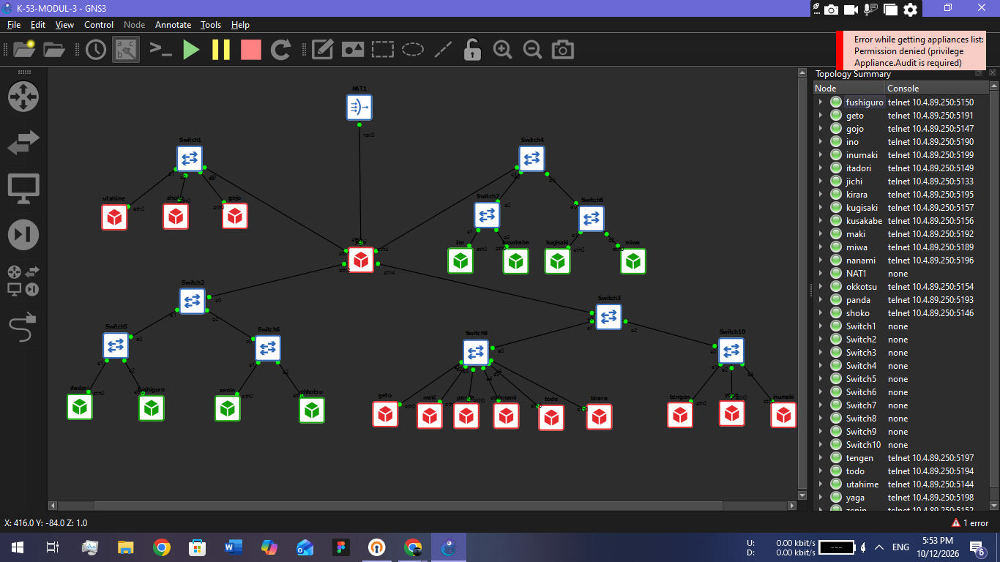

Pemetaan interface **jichi** terhadap switch:

| Interface | Terhubung ke | Node | Network | Subnet |
|---|---|---|---|---|
| eth0 | NAT1 | - | WAN | 192.168.122.0/24 |
| eth1 | Switch1 | utahime, shoko, gojo | Network 1 (DMZ) | 10.90.1.0/24 |
| eth2 | Switch2 | itadori, fushiguro, zenin, okkotsu | Network 2 (Divisi A) | 10.90.2.0/24 |
| eth3 | Switch4 | ino, kusakabe, kugisaki, miwa | Network 3 (Divisi B) | 10.90.3.0/24 |
| eth4 | Switch3 | geto, maki, panda, nanami, todo, kirara, tengen, yaga, inumaki | Network 4 (Data Center) | 10.90.4.0/24 |

> Nama switch di GNS3 tidak sama dengan nomor network (Switch4 = Network 3, Switch3 = Network 4). Yang dijadikan patokan adalah isi switch dan nomor interface jichi: eth3 harus ke Network 3 dan eth4 ke Network 4.

#### Alamat host infrastruktur (IP statis)

| Node | Network | IP | Gateway |
|---|---|---|---|
| jichi | 1 - 4 | eth1 `10.90.1.1`, eth2 `10.90.2.1`, eth3 `10.90.3.1`, eth4 `10.90.4.1` | - |
| utahime | 1 | 10.90.1.2/24 | 10.90.1.1 |
| shoko | 1 | 10.90.1.3/24 | 10.90.1.1 |
| gojo | 1 | 10.90.1.4/24 | 10.90.1.1 |
| tengen | 4 | 10.90.4.10/24 | 10.90.4.1 |
| geto | 4 | 10.90.4.20/24 | 10.90.4.1 |
| maki | 4 | 10.90.4.31/24 | 10.90.4.1 |
| panda | 4 | 10.90.4.32/24 | 10.90.4.1 |
| nanami | 4 | 10.90.4.41/24 | 10.90.4.1 |
| todo | 4 | 10.90.4.42/24 | 10.90.4.1 |
| kirara | 4 | 10.90.4.43/24 | 10.90.4.1 |
| yaga | 4 | 10.90.4.51/24 | 10.90.4.1 |
| inumaki | 4 | 10.90.4.52/24 | 10.90.4.1 |

Client Network 2 dan 3 (itadori, fushiguro, zenin, okkotsu, ino, kusakabe, kugisaki, miwa) tidak diberi IP statis karena akan memperoleh alamat dari DHCP pada soal berikutnya.

#### Persiapan

1. Pastikan link jichi sesuai tabel pemetaan di atas.
2. Jalankan semua node dengan tombol **Start** di GNS3.
3. Buka konsol tiap node (telnet ke alamat yang tertera di Topology Summary).

---

#### 1. Router (jichi)

Buka konsol jichi, lalu jalankan:
```bash
cat > /root/jichi.sh << 'EOF'
#!/bin/bash
# --- WAN: eth0 ke NAT GNS3 ---
ip addr flush dev eth0
ip addr add 192.168.122.153/24 dev eth0
ip link set eth0 up
ip route replace default via 192.168.122.1

# --- LAN: eth1 - eth4 menjadi gateway Network 1 - 4 ---
for i in 1 2 3 4; do
  ip addr flush dev eth$i
  ip addr add 10.90.$i.1/24 dev eth$i
  ip link set eth$i up
done

# Resolver sementara supaya nama domain bisa dipakai
echo "nameserver 192.168.122.1" > /etc/resolv.conf

# Aktifkan IPv4 forwarding dan source NAT
sysctl -w net.ipv4.ip_forward=1
iptables -t nat -F POSTROUTING
iptables -t nat -A POSTROUTING -o eth0 -s 10.90.0.0/16 -j MASQUERADE
EOF

bash /root/jichi.sh
```

Penjelasan:

| Perintah | Fungsi |
|---|---|
| `ip addr flush dev ethX` | Membersihkan IP lama supaya script aman dijalankan berulang |
| `ip addr add ... dev ethX` | Memasang IP gateway pada tiap network (`10.90.N.1/24`) |
| `ip link set ethX up` | Mengaktifkan interface |
| `ip route replace default via 192.168.122.1` | Default route jichi menuju gateway NAT GNS3 |
| `sysctl -w net.ipv4.ip_forward=1` | Mengizinkan jichi meneruskan paket antar network |
| `iptables -t nat ... MASQUERADE` | Source NAT: paket dari `10.90.0.0/16` yang keluar lewat eth0 disamarkan dengan IP WAN jichi |

> Awalnya eth0 diminta lewat `dhclient eth0`, tetapi pada lingkungan ini eth0 tidak memperoleh IPv4 dari NAT (hanya alamat IPv6 link-local), sehingga ping ke internet gagal dengan `Network is unreachable`. Karena itu eth0 diberi alamat statis `192.168.122.153/24` dengan gateway `192.168.122.1`. Alamat `.153` dipilih karena subnet NAT dipakai bersama; ganti angka lain bila terjadi bentrok alamat.

Verifikasi di jichi:
```bash
ip -br addr
ip route
sysctl net.ipv4.ip_forward
iptables -t nat -L POSTROUTING -n -v
ping -c 3 192.168.122.1
ping -c 3 8.8.8.8
ping -c 3 google.com
```
Hasil yang diharapkan:
- eth1 `10.90.1.1`, eth2 `10.90.2.1`, eth3 `10.90.3.1`, eth4 `10.90.4.1`, eth0 `192.168.122.153`.
- `default via 192.168.122.1 dev eth0` ada di tabel routing.
- `net.ipv4.ip_forward = 1`.
- Ada aturan `MASQUERADE` pada interface keluar `eth0` dengan source `10.90.0.0/16`.
- Ketiga ping berhasil tanpa packet loss.
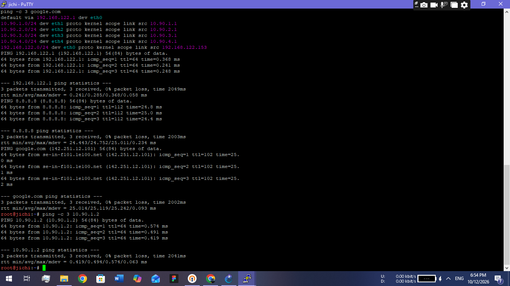


---

#### 2. Network 1 (utahime, shoko, gojo) - Gateway: 10.90.1.1

utahime:
```bash
cat > /root/utahime.sh << 'EOF'
ip addr flush dev eth0
ip addr add 10.90.1.2/24 dev eth0
ip link set eth0 up
ip route replace default via 10.90.1.1
echo "nameserver 192.168.122.1" > /etc/resolv.conf
EOF

bash /root/utahime.sh
```
shoko:
```bash
cat > /root/shoko.sh << 'EOF'
ip addr flush dev eth0
ip addr add 10.90.1.3/24 dev eth0
ip link set eth0 up
ip route replace default via 10.90.1.1
echo "nameserver 192.168.122.1" > /etc/resolv.conf
EOF

bash /root/shoko.sh
```
gojo:
```bash
cat > /root/gojo.sh << 'EOF'
ip addr flush dev eth0
ip addr add 10.90.1.4/24 dev eth0
ip link set eth0 up
ip route replace default via 10.90.1.1
echo "nameserver 192.168.122.1" > /etc/resolv.conf
EOF

bash /root/gojo.sh
```

---

#### 3. Network 4 (tengen, geto, maki, panda, nanami, todo, kirara, yaga, inumaki) - Gateway: 10.90.4.1

tengen:
```bash
cat > /root/tengen.sh << 'EOF'
ip addr flush dev eth0
ip addr add 10.90.4.10/24 dev eth0
ip link set eth0 up
ip route replace default via 10.90.4.1
echo "nameserver 192.168.122.1" > /etc/resolv.conf
EOF

bash /root/tengen.sh
```
geto:
```bash
cat > /root/geto.sh << 'EOF'
ip addr flush dev eth0
ip addr add 10.90.4.20/24 dev eth0
ip link set eth0 up
ip route replace default via 10.90.4.1
echo "nameserver 192.168.122.1" > /etc/resolv.conf
EOF

bash /root/geto.sh
```
maki:
```bash
cat > /root/maki.sh << 'EOF'
ip addr flush dev eth0
ip addr add 10.90.4.31/24 dev eth0
ip link set eth0 up
ip route replace default via 10.90.4.1
echo "nameserver 192.168.122.1" > /etc/resolv.conf
EOF

bash /root/maki.sh
```
panda:
```bash
cat > /root/panda.sh << 'EOF'
ip addr flush dev eth0
ip addr add 10.90.4.32/24 dev eth0
ip link set eth0 up
ip route replace default via 10.90.4.1
echo "nameserver 192.168.122.1" > /etc/resolv.conf
EOF

bash /root/panda.sh
```
nanami:
```bash
cat > /root/nanami.sh << 'EOF'
ip addr flush dev eth0
ip addr add 10.90.4.41/24 dev eth0
ip link set eth0 up
ip route replace default via 10.90.4.1
echo "nameserver 192.168.122.1" > /etc/resolv.conf
EOF

bash /root/nanami.sh
```
todo:
```bash
cat > /root/todo.sh << 'EOF'
ip addr flush dev eth0
ip addr add 10.90.4.42/24 dev eth0
ip link set eth0 up
ip route replace default via 10.90.4.1
echo "nameserver 192.168.122.1" > /etc/resolv.conf
EOF

bash /root/todo.sh
```
kirara:
```bash
cat > /root/kirara.sh << 'EOF'
ip addr flush dev eth0
ip addr add 10.90.4.43/24 dev eth0
ip link set eth0 up
ip route replace default via 10.90.4.1
echo "nameserver 192.168.122.1" > /etc/resolv.conf
EOF

bash /root/kirara.sh
```
yaga:
```bash
cat > /root/yaga.sh << 'EOF'
ip addr flush dev eth0
ip addr add 10.90.4.51/24 dev eth0
ip link set eth0 up
ip route replace default via 10.90.4.1
echo "nameserver 192.168.122.1" > /etc/resolv.conf
EOF

bash /root/yaga.sh
```
inumaki:
```bash
cat > /root/inumaki.sh << 'EOF'
ip addr flush dev eth0
ip addr add 10.90.4.52/24 dev eth0
ip link set eth0 up
ip route replace default via 10.90.4.1
echo "nameserver 192.168.122.1" > /etc/resolv.conf
EOF

bash /root/inumaki.sh
```

Penjelasan script host (sama untuk semua node, hanya IP dan gateway yang berbeda):

| Perintah | Fungsi |
|---|---|
| `ip addr flush dev eth0` | Membersihkan IP lama |
| `ip addr add <IP>/24 dev eth0` | Memasang IP statis |
| `ip link set eth0 up` | Mengaktifkan interface |
| `ip route replace default via <gateway>` | Default gateway menuju jichi |
| `echo "nameserver 192.168.122.1" > /etc/resolv.conf` | Resolver sementara agar `apt` dan nama domain bisa dipakai |

---

#### Verifikasi Soal 1

**a. Konektivitas ke gateway (semua host infrastruktur)**

Jalankan di setiap host. Gateway-nya `10.90.1.1` untuk utahime, shoko, dan gojo, serta `10.90.4.1` untuk tengen, geto, maki, panda, nanami, todo, kirara, yaga, dan inumaki:
```bash
ip -br addr
ping -c 3 <gateway>
```
**b. Akses eksternal (host yang relevan: jichi, tengen, utahime, shoko - tapi semua host saya juga pakai karena why not?)**

```bash
ping -c 3 8.8.8.8          # jalur NAT lewat jichi
ping -c 3 google.com       # resolver 192.168.122.1
```
##### Bukti :
utahime :
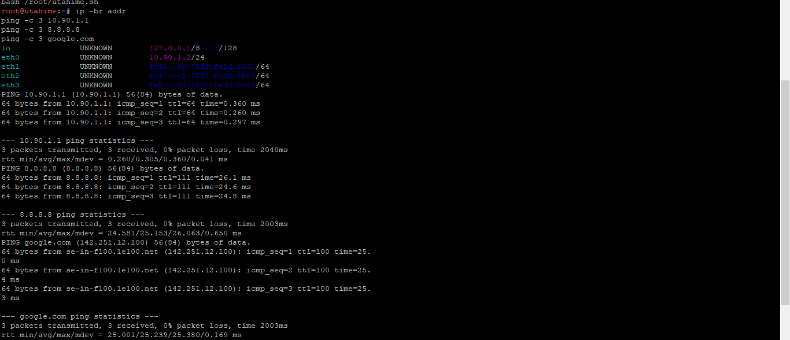\
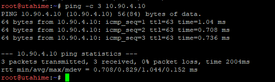\
shoko :

gojo :

tengen :
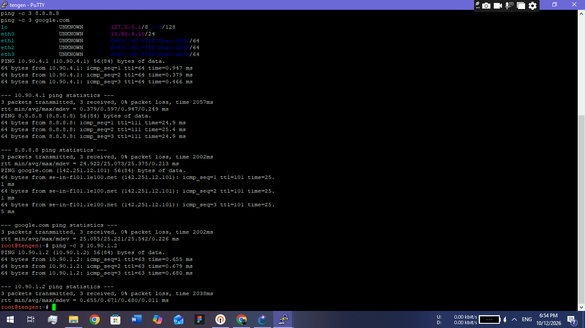
geto :

maki :

panda :

nanami :

todo :
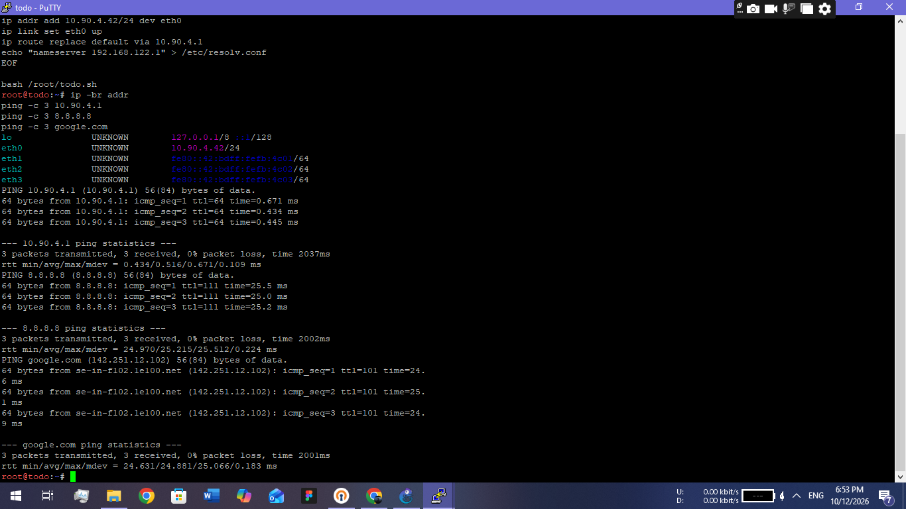
kirara :

yaga :

inumaki :


**c. Routing antar network lewat jichi**

Dari tengen (Network 4) ke utahime (Network 1):
```bash
ping -c 3 10.90.1.2
```
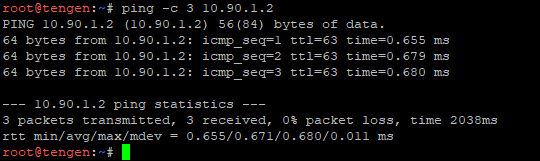

Dari utahime ke tengen:
```bash
ping -c 3 10.90.4.10
```


TTL yang turun menjadi 63 menandakan paket melewati satu router (jichi).

> Jika node di-stop lalu di-start lagi, konfigurasi IP hilang. Cukup jalankan ulang script di `/root` pada node tersebut (`bash /root/jichi.sh`, `bash /root/tengen.sh`, dan seterusnya).

---

### Soal 2 : DHCP Server (tengen), Subnet Lokal Tanpa Pool, dan Scope Network 2 & 3
 
Pada soal ini tengen (`10.90.4.10`, Network 4 / Data Center) disiapkan sebagai DHCP server untuk seluruh jaringan. Ada empat hal yang dikerjakan:
 
1. Install `isc-dhcp-server` di tengen.
2. Deklarasikan Network 4 sebagai subnet lokal **tanpa pool** (tanpa `range`).
3. Siapkan scope untuk Network 2 dan Network 3.
4. Validasi konfigurasi sampai tidak ada error **"No subnet declaration for eth0"**.
#### Gambaran scope
 
| Network | Subnet | Gateway | Pool | Keterangan |
|---|---|---|---|---|
| Network 4 (Data Center) | 10.90.4.0/24 | 10.90.4.1 | tidak ada | Hanya deklarasi subnet lokal, supaya dhcpd bisa jalan di eth0 |
| Network 2 (Divisi A) | 10.90.2.0/24 | 10.90.2.1 | 10.90.2.10 - 10.90.2.35 | Sementara, kebijakan pool final diganti di Soal 4 |
| Network 3 (Divisi B) | 10.90.3.0/24 | 10.90.3.1 | 10.90.3.10 - 10.90.3.89 | Sementara, kebijakan pool final diganti di Soal 5 |
 
Opsi yang dibagikan ke client Network 2 dan 3: DNS `10.90.1.2` dan `10.90.1.3` (utahime dan shoko), serta domain-search `K53.com`.
 
> Semua langkah dikerjakan di konsol **tengen**.
 
---
 
#### 1. Install dan konfigurasi (tengen)
 
Buka konsol tengen, lalu jalankan:
```bash
cat > /root/tengen-dhcp.sh << 'EOF'
#!/bin/bash
export DEBIAN_FRONTEND=noninteractive
echo "nameserver 192.168.122.1" > /etc/resolv.conf
apt update && apt install -y isc-dhcp-server
 
# DHCP hanya dilayani lewat eth0 (Network 4)
sed -i 's/^INTERFACESv4=.*/INTERFACESv4="eth0"/' /etc/default/isc-dhcp-server
 
# File utama
cat > /etc/dhcp/dhcpd.conf << 'EOT'
ddns-update-style none;
authoritative;
default-lease-time 600;
max-lease-time 7200;
 
# Network 4 (Data Center): subnet lokal tanpa pool dinamis
subnet 10.90.4.0 netmask 255.255.255.0 {
}
 
# Network 2 dan 3 dipisah ke file masing-masing
include "/etc/dhcp/net2.conf";
include "/etc/dhcp/net3.conf";
EOT
 
# Scope sementara Network 2 (akan diganti di Soal 4)
cat > /etc/dhcp/net2.conf << 'EOT'
subnet 10.90.2.0 netmask 255.255.255.0 {
  range 10.90.2.10 10.90.2.35;
  option routers 10.90.2.1;
  option broadcast-address 10.90.2.255;
  option domain-name-servers 10.90.1.2, 10.90.1.3;
  option domain-search "K53.com";
}
EOT
 
# Scope sementara Network 3 (akan diganti di Soal 5)
cat > /etc/dhcp/net3.conf << 'EOT'
subnet 10.90.3.0 netmask 255.255.255.0 {
  range 10.90.3.10 10.90.3.89;
  option routers 10.90.3.1;
  option broadcast-address 10.90.3.255;
  option domain-name-servers 10.90.1.2, 10.90.1.3;
  option domain-search "K53.com";
}
EOT
 
touch /var/lib/dhcp/dhcpd.leases
dhcpd -t -cf /etc/dhcp/dhcpd.conf && service isc-dhcp-server restart
EOF
 
bash /root/tengen-dhcp.sh
```
 
Penjelasan:
 
| Bagian | Fungsi |
|---|---|
| `apt install isc-dhcp-server` | Memasang DHCP server (butuh internet, tengen sudah terhubung lewat jichi pada Soal 1) |
| `INTERFACESv4="eth0"` | DHCP hanya mendengarkan di eth0, yang berada di Network 4 |
| `ddns-update-style none` | Menonaktifkan dynamic DNS update (tidak dipakai) |
| `authoritative` | tengen menjadi server resmi untuk subnet yang dideklarasikan |
| `default-lease-time` dan `max-lease-time` | Lama lease default (600 detik) dan maksimum (7200 detik) |
| `subnet 10.90.4.0 ... { }` | Network 4 dideklarasikan **tanpa `range`**. Ini yang menghilangkan error "No subnet declaration for eth0", karena dhcpd mewajibkan ada subnet yang cocok dengan IP interface yang dipakai |
| `net2.conf` dan `net3.conf` | Scope Network 2 dan 3 dipisah ke file masing-masing lewat `include`. Rentang di sini **sementara** supaya Soal 3 (relay) bisa dibuktikan. Kebijakan pool sebenarnya diganti di Soal 4 dan 5 |
| `option routers` dan `broadcast-address` | Gateway dan broadcast tiap network |
| `domain-name-servers` dan `domain-search` | DNS `10.90.1.2` dan `10.90.1.3`, domain-search `K53.com` |
| `touch /var/lib/dhcp/dhcpd.leases` | Memastikan file lease ada, supaya dhcpd tidak gagal start |
| `dhcpd -t -cf ...` | Validasi sintaks sebelum service di-restart |
 
---
 
#### Verifikasi Soal 2
 
Jalankan di tengen:
```bash
dhcpd -t -cf /etc/dhcp/dhcpd.conf
service isc-dhcp-server status
ss -ulnp | grep :67
grep INTERFACES /etc/default/isc-dhcp-server
```
 
Hasil yang diharapkan:
- `dhcpd -t` tidak mengeluarkan error. Pesan **"No subnet declaration for eth0"** tidak muncul.
- Status service **running**.
- `ss` menampilkan `dhcpd` mendengarkan di port 67 (`0.0.0.0:67`).
- `INTERFACESv4="eth0"`.
##### Bukti :\
tengen :\
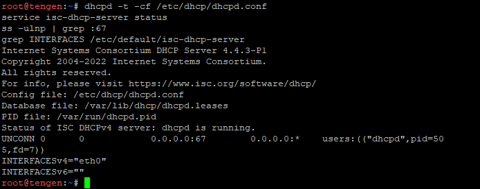
 
Hasil di atas sesuai harapan: validasi konfigurasi lolos tanpa error, `dhcpd is running`, dhcpd mendengarkan di port 67, dan `INTERFACESv4="eth0"`.
 
> Jika tengen di-stop lalu di-start lagi, konfigurasi IP hilang dan paket yang terpasang bisa ikut hilang. Jalankan ulang `bash /root/tengen.sh` (Soal 1), lalu `bash /root/tengen-dhcp.sh`.
 
---

### Soal 3 : DHCP Relay (jichi)

Permintaan alamat dari Divisi A (Network 2) dan Divisi B (Network 3) berupa broadcast, sehingga tidak bisa menyeberangi subnet secara langsung menuju DHCP server di Network 4. Pada soal ini jichi dikonfigurasi sebagai **DHCP Relay** menuju tengen (`10.90.4.10`), menggunakan **eth2** untuk Network 2 dan **eth3** untuk Network 3. Setelah itu dibuktikan bahwa client dari kedua subnet berhasil memperoleh lease melalui relay.

#### Alur kerja

| Langkah | Keterangan |
|---|---|
| 1 | Client di Network 2 atau 3 mengirim DHCPDISCOVER (broadcast) |
| 2 | jichi menerima di eth2 atau eth3, lalu meneruskan ke tengen `10.90.4.10` lewat eth4 dengan alamat relay (giaddr) `10.90.2.1` atau `10.90.3.1` |
| 3 | tengen mencocokkan giaddr dengan subnet yang sesuai (`net2.conf` atau `net3.conf`) dan mengirim penawaran |
| 4 | jichi meneruskan balasan ke client |

> Semua langkah konfigurasi dikerjakan di konsol **jichi**. Verifikasi dikerjakan di client dan tengen.

---

#### 1. Konfigurasi relay (jichi)

Buka konsol jichi, lalu jalankan:
```bash
cat > /root/jichi-relay.sh << 'EOF'
#!/bin/bash
export DEBIAN_FRONTEND=noninteractive
apt update && apt install -y isc-dhcp-relay

cat > /etc/default/isc-dhcp-relay << 'EOT'
SERVERS="10.90.4.10"
INTERFACES="eth2 eth3 eth4"
OPTIONS=""
EOT

service isc-dhcp-relay restart
EOF

bash /root/jichi-relay.sh
```

Penjelasan:

| Bagian | Fungsi |
|---|---|
| `apt install isc-dhcp-relay` | Memasang DHCP relay agent (`dhcrelay`) |
| `SERVERS="10.90.4.10"` | Alamat DHCP server (tengen) tujuan forward |
| `INTERFACES="eth2 eth3 eth4"` | eth2 dan eth3 menerima permintaan dari client Network 2 dan 3. eth4 adalah jalur menuju tengen, dimasukkan supaya balasan server dapat diterima relay |
| `service isc-dhcp-relay restart` | Menjalankan relay dengan konfigurasi baru |

> Saat instalasi muncul pesan `invoke-rc.d: policy-rc.d denied execution of start`. Ini normal di container: service tidak otomatis start setelah install, sehingga `service isc-dhcp-relay restart` pada script yang menjalankannya.

Verifikasi di jichi:
```bash
service isc-dhcp-relay status
ps aux | grep [d]hcrelay
cat /etc/default/isc-dhcp-relay
```
Hasil yang diharapkan:
- Proses `/usr/sbin/dhcrelay -q -i eth2 -i eth3 -i eth4 10.90.4.10` berjalan.
- `SERVERS="10.90.4.10"` dan `INTERFACES="eth2 eth3 eth4"`.

##### Bukti :
jichi :
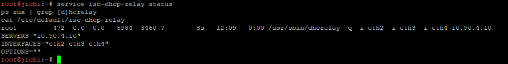

---

#### 2. Client memperoleh lease lewat relay

Jalankan di satu client Network 2 (itadori) dan satu client Network 3 (ino):
```bash
ip link set eth0 up
udhcpc -i eth0
ip -br addr
ip route
cat /etc/resolv.conf
ping -c 3 10.90.4.10
```

Hasil yang diharapkan:
- itadori memperoleh IP dari pool Network 2 (`10.90.2.10 - 10.90.2.35`) dengan gateway `10.90.2.1`.
- ino memperoleh IP dari pool Network 3 (`10.90.3.10 - 10.90.3.89`) dengan gateway `10.90.3.1`.
- `resolv.conf` berisi nameserver `10.90.1.2` dan `10.90.1.3`.
- Ping ke tengen berhasil. TTL 63 menandakan paket melewati satu router (jichi).

##### Bukti :
itadori (Network 2) : memperoleh `10.90.2.10/24`, server `10.90.4.10`, lease time 600, default via `10.90.2.1`.
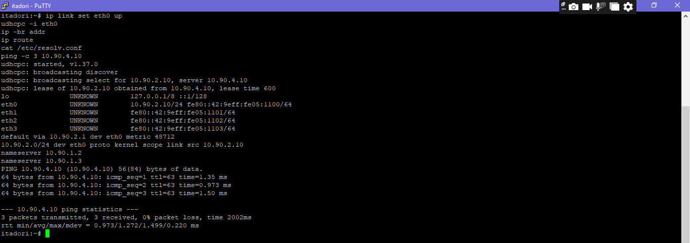

ino (Network 3) : memperoleh `10.90.3.10/24`, server `10.90.4.10`, lease time 600, default via `10.90.3.1`.
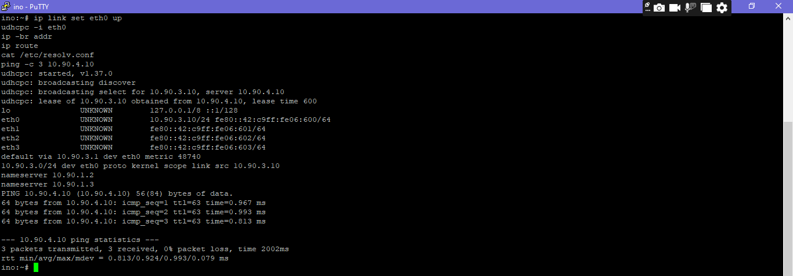

---

#### 3. Bukti di sisi server (tengen)

```bash
grep -E "lease|client-hostname|hardware" /var/lib/dhcp/dhcpd.leases | tail -20
```

Hasil yang diharapkan: tengen mencatat dua lease dari subnet berbeda (`10.90.2.10` dan `10.90.3.10`) dengan MAC address masing-masing client.

##### Bukti :
tengen :
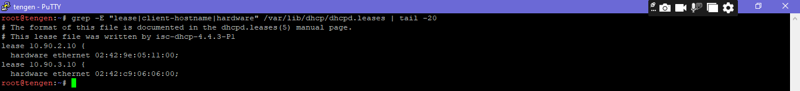

MAC `02:42:9e:05:11:00` adalah eth0 itadori dan `02:42:c9:06:06:00` adalah eth0 ino, sesuai dengan alamat link-local pada output `ip -br addr` di masing-masing client.

> Jika jichi di-stop lalu di-start lagi, konfigurasi IP hilang dan relay tidak berjalan. Jalankan ulang `bash /root/jichi.sh`, lalu `service isc-dhcp-relay restart`.

---

### Soal 4 : Dua Pool DHCP pada Network 2 dengan DHCP Class (tengen)

Tim Dev dan Support di Divisi A (Network 2) harus menerima jatah alamat yang berbeda, padahal semua client berada pada subnet yang sama (`10.90.2.0/24`). Karena itu pada soal ini scope sementara Network 2 dari Soal 2 diganti dengan **dua pool** yang dipisahkan memakai **DHCP class berdasarkan MAC address**.

#### Gambaran pembagian

| Pool | Client | Rentang IP | Keterangan |
|---|---|---|---|
| Pool 1 | itadori, fushiguro | 10.90.2.10 - 10.90.2.35 | Dev |
| Pool 2 | zenin, okkotsu | 10.90.2.70 - 10.90.2.95 | Support |
| - | - | 10.90.2.36 - 10.90.2.69 | **Tidak boleh dialokasikan** (sengaja tidak dimasukkan ke pool mana pun) |

MAC address eth0 tiap client (diambil dari `ip link show eth0` atau dari alamat link-local pada `ip -br addr`):

| Client | MAC address eth0 | Class |
|---|---|---|
| itadori | `02:42:9e:05:11:00` | pool1 |
| fushiguro | `02:42:d6:c7:fd:00` | pool1 |
| zenin | `02:42:a7:06:c5:00` | pool2 |
| okkotsu | `02:42:1e:db:db:00` | pool2 |

> Semua langkah konfigurasi dikerjakan di konsol **tengen**. Verifikasi dikerjakan di keempat client dan tengen.

---

#### 1. Konfigurasi class dan pool (tengen)

Buka konsol tengen, lalu jalankan:
```bash
cat > /root/tengen-net2.sh << 'EOF'
#!/bin/bash
MAC_ITADORI="02:42:9e:05:11:00"
MAC_FUSHIGURO="02:42:d6:c7:fd:00"
MAC_ZENIN="02:42:a7:06:c5:00"
MAC_OKKOTSU="02:42:1e:db:db:00"

cat > /etc/dhcp/net2.conf << EOT
# Kelas client Network 2 berdasarkan MAC address
class "pool1" {
  match hardware;
}
subclass "pool1" 1:$MAC_ITADORI;
subclass "pool1" 1:$MAC_FUSHIGURO;

class "pool2" {
  match hardware;
}
subclass "pool2" 1:$MAC_ZENIN;
subclass "pool2" 1:$MAC_OKKOTSU;

subnet 10.90.2.0 netmask 255.255.255.0 {
  option subnet-mask 255.255.255.0;
  option routers 10.90.2.1;
  option broadcast-address 10.90.2.255;
  option domain-name-servers 10.90.1.2, 10.90.1.3;
  option domain-search "K53.com";

  # Pool 1: itadori dan fushiguro
  pool {
    allow members of "pool1";
    range 10.90.2.10 10.90.2.35;
  }

  # Pool 2: zenin dan okkotsu
  pool {
    allow members of "pool2";
    range 10.90.2.70 10.90.2.95;
  }
  # 10.90.2.36 - 10.90.2.69 sengaja tidak dimasukkan ke pool mana pun
}
EOT

dhcpd -t -cf /etc/dhcp/dhcpd.conf && service isc-dhcp-server restart
EOF

bash /root/tengen-net2.sh
```

Penjelasan:

| Bagian | Fungsi |
|---|---|
| `class "pool1" { match hardware; }` | Membuat kelas yang mencocokkan client berdasarkan hardware address (tipe + MAC) dari paket DHCP |
| `subclass "pool1" 1:<MAC>` | Memasukkan satu MAC ke kelas `pool1`. Awalan `1:` adalah tipe hardware Ethernet |
| `pool { allow members of "pool1"; range ...; }` | Pool hanya boleh dipakai anggota kelas `pool1`, dengan rentang `10.90.2.10 - 10.90.2.35` |
| `pool { allow members of "pool2"; range ...; }` | Pool hanya boleh dipakai anggota kelas `pool2`, dengan rentang `10.90.2.70 - 10.90.2.95` |
| `10.90.2.36 - 10.90.2.69` | Tidak ada `range` yang mencakupnya, sehingga dhcpd tidak akan pernah mengalokasikannya |
| `option routers/broadcast/domain-name-servers/domain-search` | Opsi yang sama seperti Soal 2: gateway `10.90.2.1`, broadcast `10.90.2.255`, DNS `10.90.1.2` dan `10.90.1.3`, domain-search `K53.com` |
| `dhcpd -t -cf ... && service ... restart` | Validasi sintaks dulu, service baru di-restart bila valid |

> File `net2.conf` sudah di-`include` dari `dhcpd.conf` pada Soal 2, jadi `dhcpd.conf` tidak perlu diubah. Script ini hanya menimpa isi `net2.conf`.

> Jika client tidak memperoleh alamat, periksa lagi MAC pada script. Pada font terminal, angka `1` bisa terlihat mirip huruf `l`, padahal hex tidak punya huruf `l`. Contohnya MAC okkotsu adalah `02:42:1e:db:db:00`, sesuai dengan alamat link-local `fe80::42:1eff:fedb:db01` pada `ip -br addr` di okkotsu.

Verifikasi konfigurasi di tengen:
```bash
dhcpd -t -cf /etc/dhcp/dhcpd.conf
service isc-dhcp-server status
cat /etc/dhcp/net2.conf
```
Hasil yang diharapkan:
- `dhcpd -t` tidak mengeluarkan error.
- Status service **dhcpd is running**.
- `net2.conf` berisi dua class, empat subclass, dan dua pool sesuai tabel di atas.

##### Bukti :
tengen :
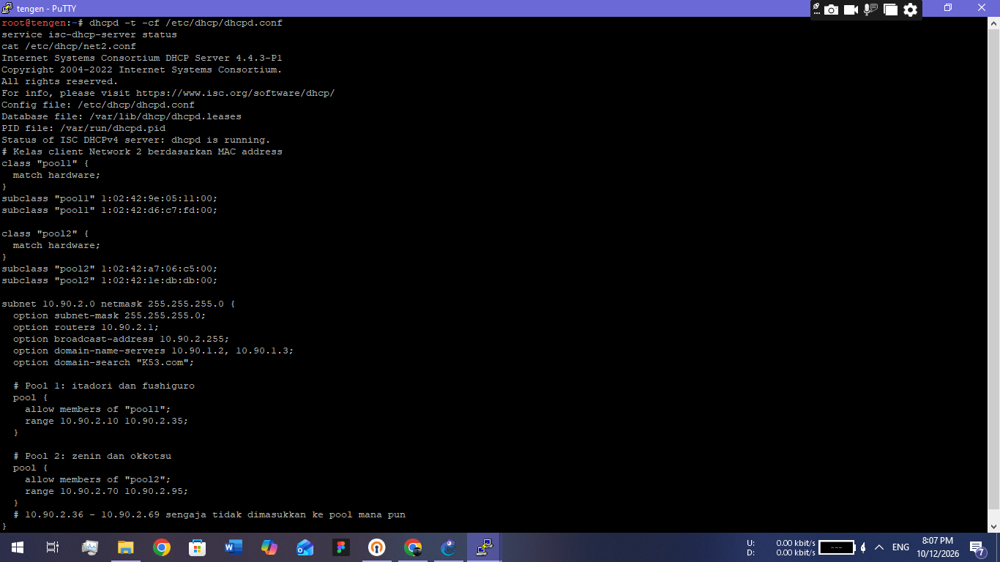

---

#### 2. Client meminta lease baru

Jalankan di keempat client (itadori, fushiguro, zenin, okkotsu):
```bash
killall udhcpc 2>/dev/null
ip addr flush dev eth0
ip link set eth0 up
udhcpc -i eth0
ip -br addr
ip route
cat /etc/resolv.conf
```

Penjelasan:

| Perintah | Fungsi |
|---|---|
| `killall udhcpc` | Menghentikan klien DHCP lama supaya tidak bentrok |
| `ip addr flush dev eth0` | Membuang IP lama (misalnya dari pool sementara Soal 2 dan 3) |
| `udhcpc -i eth0` | Meminta lease baru. Permintaan melewati jichi (relay) menuju tengen |
| `ip -br addr`, `ip route`, `cat /etc/resolv.conf` | Memeriksa IP, gateway, dan DNS yang diterima |

Hasil yang diharapkan:
- itadori dan fushiguro memperoleh IP di `10.90.2.10 - 10.90.2.35`.
- zenin dan okkotsu memperoleh IP di `10.90.2.70 - 10.90.2.95`.
- Gateway `10.90.2.1`, DNS `10.90.1.2` dan `10.90.1.3`.

##### Bukti :
itadori (Pool 1) : memperoleh `10.90.2.10/24` dari server `10.90.4.10`, default via `10.90.2.1`, nameserver `10.90.1.2` dan `10.90.1.3`.
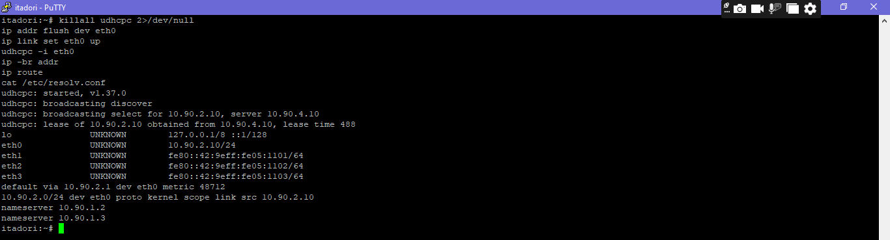

fushiguro (Pool 1) : memperoleh `10.90.2.11/24` dari server `10.90.4.10`, default via `10.90.2.1`, nameserver `10.90.1.2` dan `10.90.1.3`.
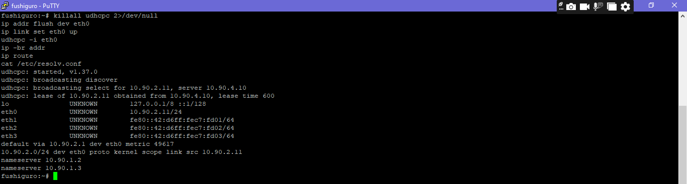

zenin (Pool 2) : memperoleh `10.90.2.70/24` dari server `10.90.4.10`, default via `10.90.2.1`, nameserver `10.90.1.2` dan `10.90.1.3`.
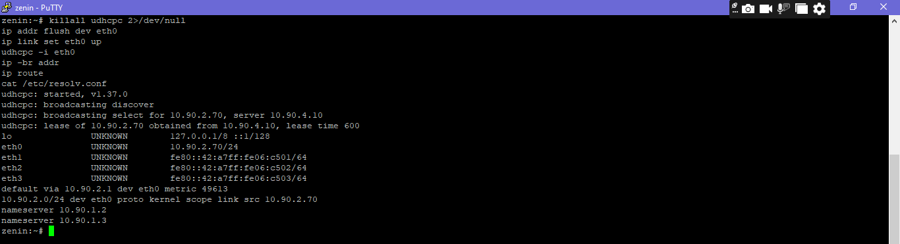

okkotsu (Pool 2) : memperoleh `10.90.2.71/24` dari server `10.90.4.10`, default via `10.90.2.1`, nameserver `10.90.1.2` dan `10.90.1.3`.
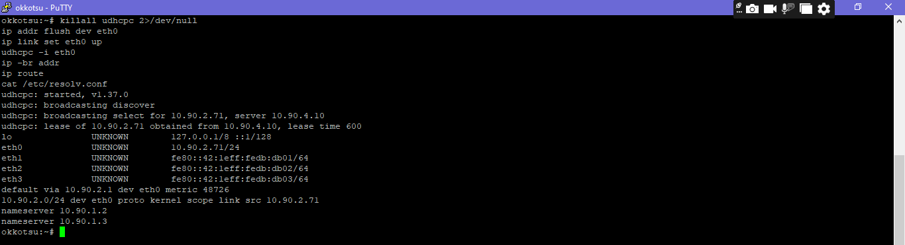

Ringkasan hasil:

| Client | Pool | IP yang diterima | Di dalam rentang? |
|---|---|---|---|
| itadori | Pool 1 | 10.90.2.10 | Ya (10 - 35) |
| fushiguro | Pool 1 | 10.90.2.11 | Ya (10 - 35) |
| zenin | Pool 2 | 10.90.2.70 | Ya (70 - 95) |
| okkotsu | Pool 2 | 10.90.2.71 | Ya (70 - 95) |

Tidak ada client yang memperoleh alamat di rentang `10.90.2.36 - 10.90.2.69`.

---

#### 3. Bukti di sisi server (tengen)

```bash
dhcpd -t -cf /etc/dhcp/dhcpd.conf
service isc-dhcp-server status
grep -E "^lease|hardware ethernet" /var/lib/dhcp/dhcpd.leases
```

Hasil yang diharapkan: tengen mencatat lease untuk keempat client Network 2, masing-masing dengan MAC yang sesuai kelasnya.

##### Bukti :
tengen :
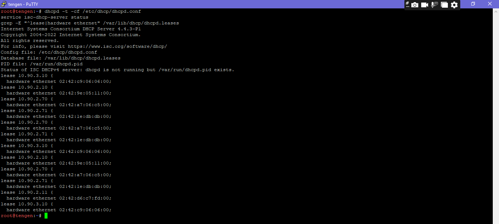

Pencocokan lease dengan MAC:

| IP | MAC address | Client | Pool |
|---|---|---|---|
| 10.90.2.10 | `02:42:9e:05:11:00` | itadori | Pool 1 |
| 10.90.2.11 | `02:42:d6:c7:fd:00` | fushiguro | Pool 1 |
| 10.90.2.70 | `02:42:a7:06:c5:00` | zenin | Pool 2 |
| 10.90.2.71 | `02:42:1e:db:db:00` | okkotsu | Pool 2 |

> Satu IP dapat muncul beberapa kali di `dhcpd.leases` karena file ini bersifat log yang terus ditambah setiap lease dibuat atau diperbarui. Entri paling bawah untuk suatu IP adalah yang berlaku.

> Pada Soal 3, itadori sudah memperoleh `10.90.2.10` dari scope sementara. Setelah pool dipisah, itadori tetap memperoleh alamat yang sama karena `10.90.2.10` memang awal Pool 1, sehingga hasilnya konsisten.

> Jika tengen di-stop lalu di-start lagi, konfigurasi IP hilang dan paket yang terpasang bisa ikut hilang. Jalankan ulang `bash /root/tengen.sh` (Soal 1), `bash /root/tengen-dhcp.sh` (Soal 2), lalu `bash /root/tengen-net2.sh` (Soal 4) agar `net2.conf` kembali berisi dua pool.

---

### Soal 5 : Short Lease dan Long Lease pada Network 3 (tengen)

Tim lapangan Divisi B (Network 3) punya durasi operasi yang berbeda. Pada soal ini scope sementara Network 3 dari Soal 2 diganti dengan **dua pool** yang dipisahkan memakai **DHCP class berdasarkan MAC address**, dan tiap kelas diberi **lease time** sendiri.

#### Gambaran pembagian

| Kelas | Client | Rentang IP | default-lease-time | max-lease-time |
|---|---|---|---|---|
| short | ino, kusakabe | 10.90.3.10 - 10.90.3.89 | 1800 detik (30 menit) | 1800 detik |
| long | miwa | 10.90.3.100 - 10.90.3.199 | 43200 detik (12 jam) | 43200 detik |

Rentang `10.90.3.90 - 10.90.3.99` tidak dimasukkan ke pool mana pun. Alamat `10.90.3.99` dicadangkan untuk fixed address kugisaki pada Soal 6.

MAC address eth0 tiap client (diambil dengan `cat /sys/class/net/eth0/address`):

| Client | MAC address eth0 | Kelas |
|---|---|---|
| ino | `02:42:c9:06:06:00` | short |
| kusakabe | `02:42:33:cb:b7:00` | short |
| miwa | `02:42:46:ce:21:00` | long |

> Semua langkah konfigurasi dikerjakan di konsol **tengen**. Verifikasi dikerjakan di ketiga client dan tengen.

---

#### 1. Konfigurasi class dan pool (tengen)

Buka konsol tengen, lalu jalankan:
```bash
cat > /root/tengen-net3.sh << 'EOF'
#!/bin/bash
MAC_INO="02:42:c9:06:06:00"
MAC_KUSAKABE="02:42:33:cb:b7:00"
MAC_MIWA="02:42:46:ce:21:00"

cat > /etc/dhcp/net3.conf << EOT
# Kelas client Network 3 berdasarkan MAC address
# Short lease: 30 menit (1800 detik)
class "short" {
  match hardware;
  default-lease-time 1800;
  max-lease-time 1800;
}
subclass "short" 1:$MAC_INO;
subclass "short" 1:$MAC_KUSAKABE;

# Long lease: 12 jam (43200 detik)
class "long" {
  match hardware;
  default-lease-time 43200;
  max-lease-time 43200;
}
subclass "long" 1:$MAC_MIWA;

subnet 10.90.3.0 netmask 255.255.255.0 {
  option subnet-mask 255.255.255.0;
  option routers 10.90.3.1;
  option broadcast-address 10.90.3.255;
  option domain-name-servers 10.90.1.2, 10.90.1.3;
  option domain-search "K53.com";

  # Pool short lease: ino dan kusakabe
  pool {
    allow members of "short";
    range 10.90.3.10 10.90.3.89;
  }

  # Pool long lease: miwa
  pool {
    allow members of "long";
    range 10.90.3.100 10.90.3.199;
  }
  # 10.90.3.90 - 10.90.3.99 tidak masuk pool mana pun (.99 untuk fixed address kugisaki di Soal 6)
}
EOT

dhcpd -t -cf /etc/dhcp/dhcpd.conf && service isc-dhcp-server restart
EOF

bash /root/tengen-net3.sh
```

Penjelasan:

| Bagian | Fungsi |
|---|---|
| `class "short" { match hardware; ... }` | Membuat kelas yang mencocokkan client berdasarkan hardware address dari paket DHCP |
| `default-lease-time` dan `max-lease-time` di dalam class | Lease time khusus untuk anggota kelas tersebut. Nilai global dari Soal 2 (600/7200) tidak diubah dan tetap berlaku untuk client lain |
| `subclass "short" 1:<MAC>` | Memasukkan satu MAC ke kelas `short`. Awalan `1:` adalah tipe hardware Ethernet |
| `pool { allow members of "short"; range ...; }` | Pool short hanya boleh dipakai anggota kelas `short`, dengan rentang `10.90.3.10 - 10.90.3.89` |
| `pool { allow members of "long"; range ...; }` | Pool long hanya boleh dipakai anggota kelas `long`, dengan rentang `10.90.3.100 - 10.90.3.199` |
| `option routers/broadcast/domain-name-servers/domain-search` | Gateway `10.90.3.1`, broadcast `10.90.3.255`, DNS `10.90.1.2` dan `10.90.1.3`, domain-search `K53.com` |
| `dhcpd -t -cf ... && service ... restart` | Validasi sintaks dulu, service baru di-restart bila valid |

> File `net3.conf` sudah di-`include` dari `dhcpd.conf` pada Soal 2, jadi `dhcpd.conf` tidak perlu diubah. Script ini hanya menimpa isi `net3.conf`.

> Client Network 3 yang MAC-nya belum terdaftar di kelas mana pun (misalnya kugisaki sebelum Soal 6) tidak akan memperoleh alamat, karena kedua pool dibatasi dengan `allow members of`.

---

#### 2. Client meminta lease baru

Jalankan di ino, kusakabe, dan miwa:
```bash
killall udhcpc 2>/dev/null
ip addr flush dev eth0
ip link set eth0 up
udhcpc -i eth0
ip -br addr
ip route
cat /etc/resolv.conf
```

Penjelasan:

| Perintah | Fungsi |
|---|---|
| `killall udhcpc` | Menghentikan klien DHCP lama supaya tidak bentrok |
| `ip addr flush dev eth0` | Membuang IP lama (dari scope sementara Soal 3) |
| `udhcpc -i eth0` | Meminta lease baru. Permintaan melewati jichi (relay) menuju tengen |
| `ip -br addr`, `ip route`, `cat /etc/resolv.conf` | Memeriksa IP, gateway, dan DNS yang diterima |

Hasil yang diharapkan:
- ino dan kusakabe memperoleh IP di `10.90.3.10 - 10.90.3.89` dengan lease time 1800.
- miwa memperoleh IP di `10.90.3.100 - 10.90.3.199` dengan lease time 43200.
- Gateway `10.90.3.1`, DNS `10.90.1.2` dan `10.90.1.3`.

##### Bukti :
ino (short lease) : memperoleh `10.90.3.10/24` dari server `10.90.4.10`, lease time 1773, default via `10.90.3.1`, nameserver `10.90.1.2` dan `10.90.1.3`.
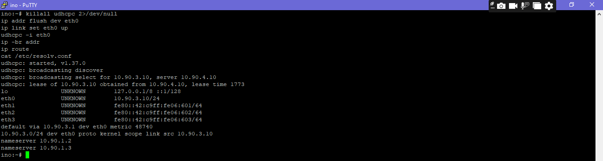

kusakabe (short lease) : memperoleh `10.90.3.11/24` dari server `10.90.4.10`, lease time 1800, default via `10.90.3.1`, nameserver `10.90.1.2` dan `10.90.1.3`.
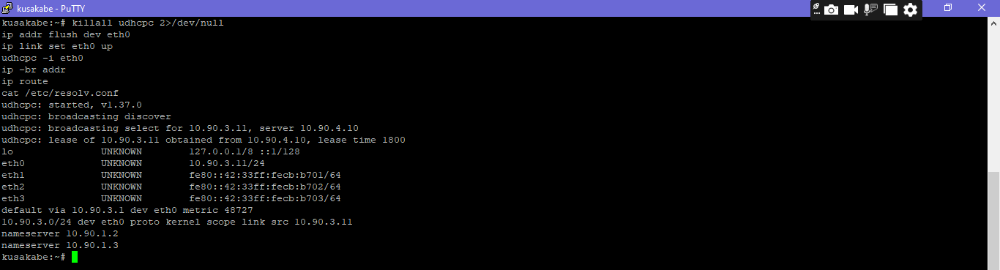

miwa (long lease) : memperoleh `10.90.3.100/24` dari server `10.90.4.10`, lease time 43200, default via `10.90.3.1`, nameserver `10.90.1.2` dan `10.90.1.3`.
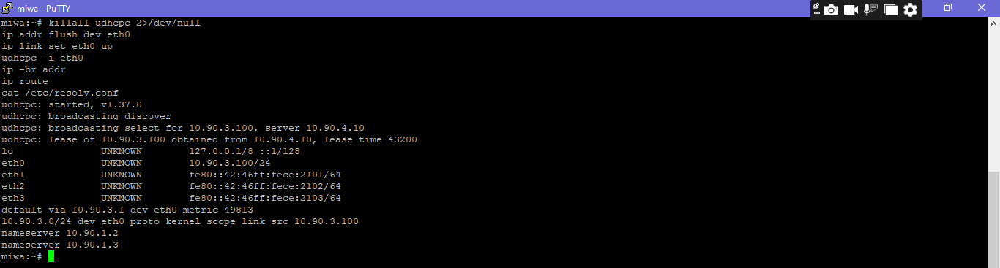

> Pada ino, lease time tertulis 1773, bukan 1800. Ini karena ino masih memegang lease `10.90.3.10` yang dibuat sebelumnya, sehingga udhcpc melaporkan **sisa** waktu lease yang sedang berjalan. Batas lease yang diberikan server tetap 1800 detik, terbukti dari kolom `ends` di `dhcpd.leases` (lihat bagian berikut).

Ringkasan hasil:

| Client | Kelas | IP yang diterima | Lease time | Di dalam rentang? |
|---|---|---|---|---|
| ino | short | 10.90.3.10 | 1773 (sisa dari 1800) | Ya (10 - 89) |
| kusakabe | short | 10.90.3.11 | 1800 | Ya (10 - 89) |
| miwa | long | 10.90.3.100 | 43200 | Ya (100 - 199) |

---

#### 3. Bukti di sisi server (tengen)

```bash
dhcpd -t -cf /etc/dhcp/dhcpd.conf
service isc-dhcp-server status
cat /etc/dhcp/net3.conf
grep -E "^lease|hardware ethernet|ends" /var/lib/dhcp/dhcpd.leases | tail -20
```

Hasil yang diharapkan:
- `dhcpd -t` tidak mengeluarkan error dan status service **dhcpd is running**.
- `net3.conf` berisi dua class, tiga subclass, dan dua pool sesuai tabel di atas.
- `dhcpd.leases` mencatat lease ino dan kusakabe berdurasi 30 menit, serta lease miwa berdurasi 12 jam.

##### Bukti :
tengen (status service dan isi `net3.conf`) :
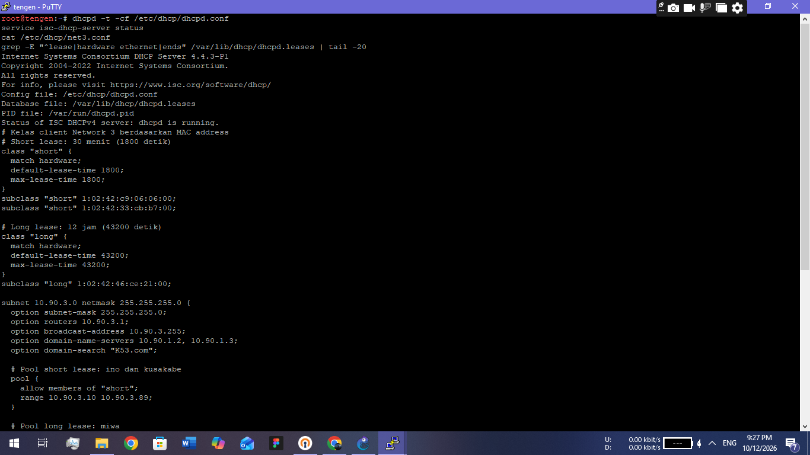
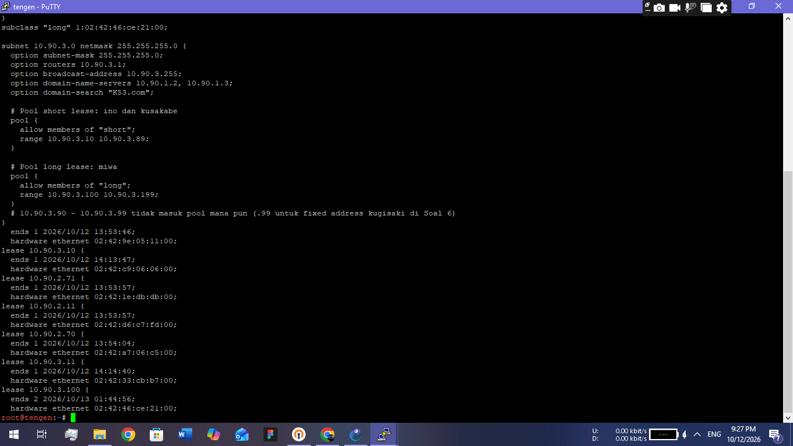

Pencocokan lease di tengen (waktu `ends` pada `dhcpd.leases` memakai UTC):

| IP | MAC address | Client | `ends` | Keterangan |
|---|---|---|---|---|
| 10.90.3.10 | `02:42:c9:06:06:00` | ino | 2026/10/12 14:13:47 | Lease dibuat 13:43:47, berdurasi 30 menit |
| 10.90.3.11 | `02:42:33:cb:b7:00` | kusakabe | 2026/10/12 14:14:40 | Lease dibuat 13:44:40, berdurasi 30 menit |
| 10.90.3.100 | `02:42:46:ce:21:00` | miwa | 2026/10/13 01:44:56 | Lease dibuat 13:44:56, berdurasi 12 jam |

Dari tabel terlihat selisih waktu lease ino dan kusakabe 30 menit, sedangkan miwa 12 jam, sesuai kebijakan short lease dan long lease.

> Entri lease Network 2 (`10.90.2.x`) yang ikut muncul pada `tail` adalah sisa lease Soal 4 dan tidak berkaitan dengan Soal 5.

> Jika tengen di-stop lalu di-start lagi, konfigurasi IP hilang dan paket yang terpasang bisa ikut hilang. Jalankan ulang `bash /root/tengen.sh` (Soal 1), `bash /root/tengen-dhcp.sh` (Soal 2), `bash /root/tengen-net2.sh` (Soal 4), lalu `bash /root/tengen-net3.sh` (Soal 5) agar `net2.conf` dan `net3.conf` kembali berisi kebijakan pool final.

---

### Soal 6 : Static Lease untuk Kugisaki (tengen)

Kugisaki ditetapkan sebagai personel VIP yang harus mempertahankan alamat yang sama setiap kali terhubung. Pada soal ini dibuat **DHCP static lease** (reservasi) berdasarkan MAC address kugisaki dengan **fixed address `10.90.3.99`**.

#### Gambaran reservasi

| Client | Network | MAC address eth0 | Fixed address |
|---|---|---|---|
| kugisaki | 3 (Divisi B) | `02:42:59:c7:e6:00` | 10.90.3.99 |

Alamat `10.90.3.99` berada **di luar seluruh pool dinamis** Network 3:

| Pool | Rentang | Mencakup 10.90.3.99? |
|---|---|---|
| short (ino, kusakabe) | 10.90.3.10 - 10.90.3.89 | Tidak |
| long (miwa) | 10.90.3.100 - 10.90.3.199 | Tidak |

MAC address diambil dengan `cat /sys/class/net/eth0/address` di kugisaki.

> Semua langkah konfigurasi dikerjakan di konsol **tengen**. Verifikasi dikerjakan di kugisaki dan tengen.

---

#### 1. Konfigurasi static lease (tengen)

Buka konsol tengen, lalu jalankan:
```bash
cat > /root/tengen-kugisaki.sh << 'EOF'
#!/bin/bash
MAC_KUGISAKI="02:42:59:c7:e6:00"

cat > /etc/dhcp/net3-static.conf << EOT
# Static lease (VIP) Network 3: kugisaki selalu memperoleh 10.90.3.99
host kugisaki {
  hardware ethernet $MAC_KUGISAKI;
  fixed-address 10.90.3.99;
}
EOT

# Tambahkan include ke dhcpd.conf hanya jika belum ada
grep -q 'net3-static.conf' /etc/dhcp/dhcpd.conf || \
  echo 'include "/etc/dhcp/net3-static.conf";' >> /etc/dhcp/dhcpd.conf

dhcpd -t -cf /etc/dhcp/dhcpd.conf && service isc-dhcp-server restart
EOF

bash /root/tengen-kugisaki.sh
```

Penjelasan:

| Bagian | Fungsi |
|---|---|
| `host kugisaki { ... }` | Reservasi alamat untuk satu client |
| `hardware ethernet <MAC>` | MAC eth0 kugisaki sebagai kunci reservasi |
| `fixed-address 10.90.3.99` | Alamat tetap yang selalu diberikan ke MAC tersebut. Berada di celah `10.90.3.90 - 10.90.3.99`, di luar pool short dan long |
| `net3-static.conf` terpisah | Reservasi disimpan di file sendiri, sehingga `tengen-net3.sh` (Soal 5) boleh dijalankan ulang tanpa menghapus reservasi |
| `grep -q ... \|\| echo ... >>` | Menambahkan `include` ke `dhcpd.conf` hanya sekali, aman dijalankan berulang |
| `dhcpd -t ... && service ... restart` | Validasi sintaks dulu, service baru di-restart bila valid |

> Kugisaki tidak dimasukkan ke kelas `short` maupun `long`, jadi alamatnya hanya berasal dari reservasi ini. Karena tidak memakai kelas, lease time-nya mengikuti nilai global (`default-lease-time 600`).

Verifikasi konfigurasi di tengen:
```bash
dhcpd -t -cf /etc/dhcp/dhcpd.conf
service isc-dhcp-server status
cat /etc/dhcp/net3-static.conf
grep -n include /etc/dhcp/dhcpd.conf
```
Hasil yang diharapkan:
- `dhcpd -t` tidak mengeluarkan error.
- Status service **dhcpd is running**.
- `net3-static.conf` berisi blok `host kugisaki` dengan MAC dan `fixed-address 10.90.3.99`.
- `dhcpd.conf` meng-include `net2.conf`, `net3.conf`, dan `net3-static.conf`.

##### Bukti :
tengen :
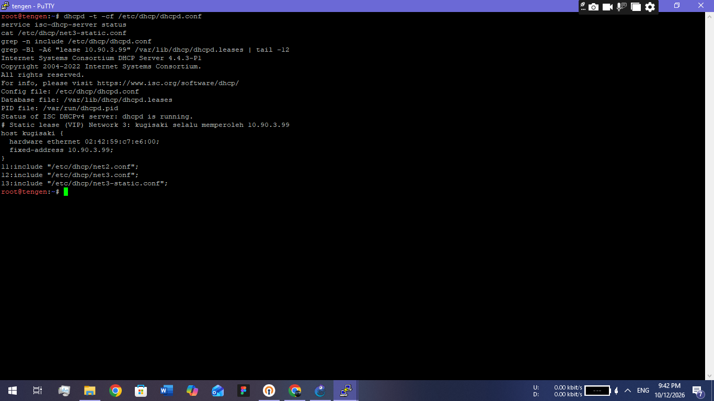

Hasil di atas sesuai harapan: validasi konfigurasi lolos tanpa error, `dhcpd is running`, blok `host kugisaki` berisi MAC `02:42:59:c7:e6:00` dan `fixed-address 10.90.3.99`, serta ketiga file ter-include di baris 11, 12, dan 13 pada `dhcpd.conf`.

---

#### 2. Renew lease di kugisaki

Jalankan di kugisaki:
```bash
killall udhcpc 2>/dev/null
ip addr flush dev eth0
ip link set eth0 up
udhcpc -i eth0
ip -br addr
ip route
cat /etc/resolv.conf
```

Lalu ulangi permintaan sekali lagi untuk membuktikan alamatnya tetap:
```bash
killall udhcpc 2>/dev/null
ip addr flush dev eth0
udhcpc -i eth0
ip -br addr
```

Penjelasan:

| Perintah | Fungsi |
|---|---|
| `killall udhcpc` | Menghentikan klien DHCP lama supaya tidak bentrok |
| `ip addr flush dev eth0` | Membuang IP lama, sehingga permintaan berikutnya benar-benar dari awal |
| `udhcpc -i eth0` | Meminta lease baru. Permintaan melewati jichi (relay) menuju tengen |
| `ip -br addr`, `ip route`, `cat /etc/resolv.conf` | Memeriksa IP, gateway, dan DNS yang diterima |

Hasil yang diharapkan:
- kugisaki memperoleh `10.90.3.99/24` dari server `10.90.4.10`.
- Gateway `10.90.3.1`, DNS `10.90.1.2` dan `10.90.1.3`.
- Alamat tetap `10.90.3.99` pada permintaan pertama maupun kedua.

##### Bukti :
kugisaki : memperoleh `10.90.3.99/24` dari server `10.90.4.10`, lease time 600, default via `10.90.3.1`, nameserver `10.90.1.2` dan `10.90.1.3`. Setelah IP dibuang dan lease diminta ulang, alamat yang diterima tetap `10.90.3.99`.
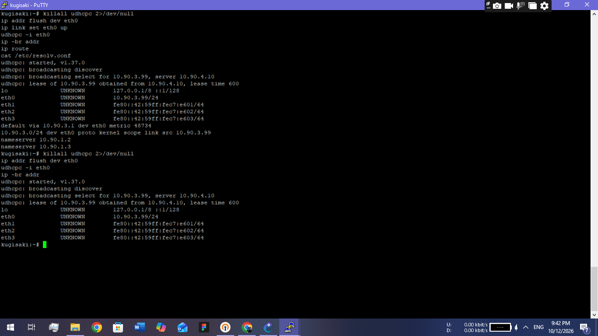

Ringkasan hasil:

| Permintaan | IP yang diterima | Server | Sesuai reservasi? |
|---|---|---|---|
| Pertama | 10.90.3.99 | 10.90.4.10 | Ya |
| Kedua (setelah flush) | 10.90.3.99 | 10.90.4.10 | Ya |

Alamat `10.90.3.99` sesuai dengan reservasi `fixed-address` pada `net3-static.conf` dan tidak berada di dalam pool short (10 - 89) maupun long (100 - 199).

> Pada `/var/lib/dhcp/dhcpd.leases`, host dengan `fixed-address` biasanya tidak dicatat sebagai lease dinamis, sehingga pencarian `lease 10.90.3.99` di file tersebut dapat kosong. Bukti reservasi ada pada blok `host kugisaki` di sisi server dan alamat yang diterima di sisi client.

> Jika tengen di-stop lalu di-start lagi, konfigurasi IP hilang dan paket yang terpasang bisa ikut hilang. Jalankan ulang `bash /root/tengen.sh` (Soal 1), `bash /root/tengen-dhcp.sh` (Soal 2), `bash /root/tengen-net2.sh` (Soal 4), `bash /root/tengen-net3.sh` (Soal 5), lalu `bash /root/tengen-kugisaki.sh` (Soal 6).

---

### Soal 7 : Verifikasi Konfigurasi Client Divisi A dan Divisi B

Setelah seluruh aturan alokasi diterapkan (Soal 2 - 6), pada soal ini dibuktikan bahwa **setiap client** menerima konfigurasi jaringan sesuai wilayahnya: subnet mask `/24`, gateway dan broadcast yang benar, DNS `10.90.1.2` dan `10.90.1.3`, serta domain-search `K53.com`. Setelah itu lease dicocokkan dengan `/var/lib/dhcp/dhcpd.leases` di tengen untuk memastikan tidak ada alamat yang bertabrakan atau berada di luar kebijakan pool.

#### Yang diverifikasi

| Aspek | Nilai yang diharapkan |
|---|---|
| Subnet mask | 255.255.255.0 (/24) |
| Gateway Network 2 | 10.90.2.1 |
| Gateway Network 3 | 10.90.3.1 |
| Broadcast Network 2 | 10.90.2.255 |
| Broadcast Network 3 | 10.90.3.255 |
| DNS | 10.90.1.2 dan 10.90.1.3 |
| Domain-search | K53.com |

> Verifikasi dikerjakan di delapan client (Divisi A: itadori, fushiguro, zenin, okkotsu. Divisi B: ino, kusakabe, miwa, kugisaki) dan di tengen.

---

#### 1. Client meminta lease baru dan memeriksa konfigurasi

Jalankan di kedelapan client:
```bash
killall udhcpc 2>/dev/null
ip addr flush dev eth0
ip link set eth0 up
udhcpc -i eth0
ip addr show eth0 | grep -E "inet |brd"
ip route
cat /etc/resolv.conf
```

Penjelasan:

| Perintah | Fungsi |
|---|---|
| `killall udhcpc` | Menghentikan klien DHCP lama supaya tidak bentrok |
| `ip addr flush dev eth0` | Membuang IP lama sehingga permintaan benar-benar dari awal |
| `udhcpc -i eth0` | Meminta lease baru lewat relay jichi menuju tengen |
| `ip addr show eth0 \| grep -E "inet \|brd"` | Menampilkan IP beserta prefix (`/24`) dan broadcast (`brd`) |
| `ip route` | Memeriksa default gateway dan route jaringan lokal |
| `cat /etc/resolv.conf` | Memeriksa DNS yang diterima |

##### Bukti :
**Divisi A (Network 2)**

itadori :


fushiguro :


zenin :
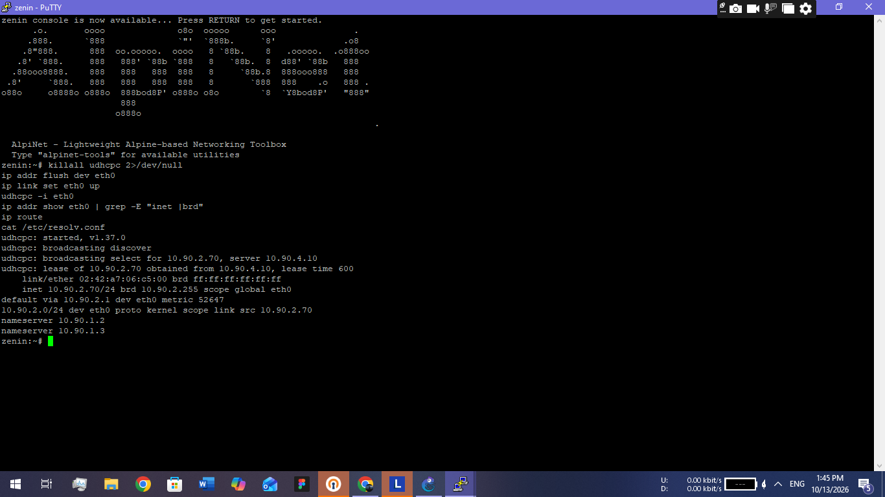

okkotsu :
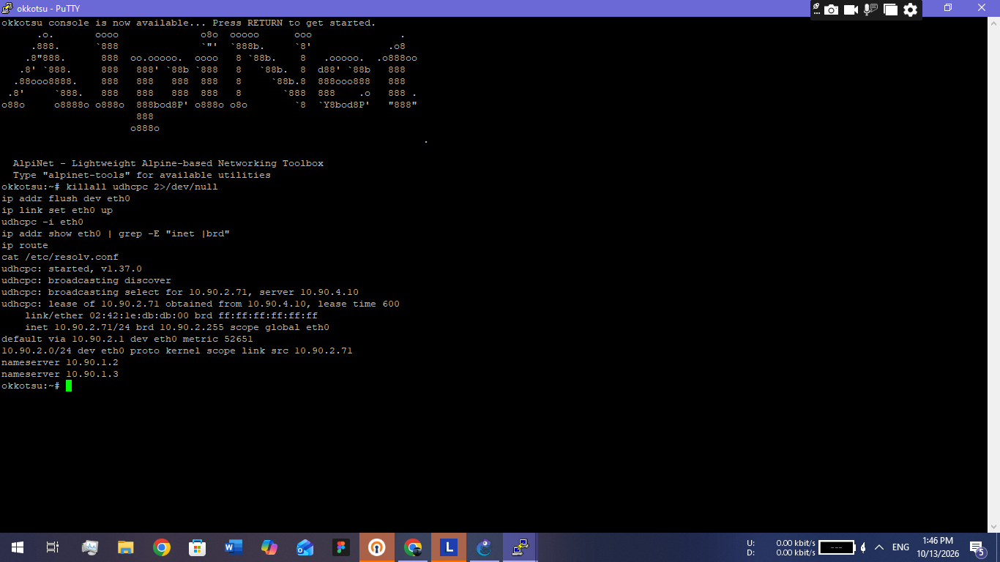

**Divisi B (Network 3)**

ino :


kusakabe :
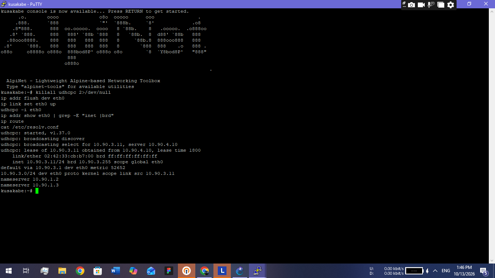

miwa :
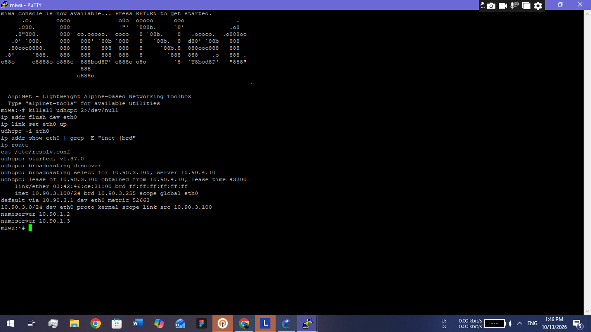

kugisaki :
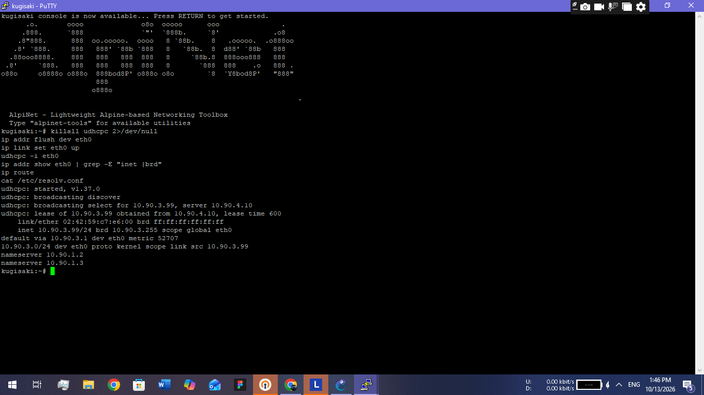

Ringkasan hasil:

| Client | Pool / kelas | IP | Mask | Gateway | Broadcast | Lease time | DNS |
|---|---|---|---|---|---|---|---|
| itadori | Pool 1 | 10.90.2.10 | /24 | 10.90.2.1 | 10.90.2.255 | 600 | 10.90.1.2, 10.90.1.3 |
| fushiguro | Pool 1 | 10.90.2.11 | /24 | 10.90.2.1 | 10.90.2.255 | 600 | 10.90.1.2, 10.90.1.3 |
| zenin | Pool 2 | 10.90.2.70 | /24 | 10.90.2.1 | 10.90.2.255 | 600 | 10.90.1.2, 10.90.1.3 |
| okkotsu | Pool 2 | 10.90.2.71 | /24 | 10.90.2.1 | 10.90.2.255 | 600 | 10.90.1.2, 10.90.1.3 |
| ino | short | 10.90.3.10 | /24 | 10.90.3.1 | 10.90.3.255 | 1800 | 10.90.1.2, 10.90.1.3 |
| kusakabe | short | 10.90.3.11 | /24 | 10.90.3.1 | 10.90.3.255 | 1800 | 10.90.1.2, 10.90.1.3 |
| miwa | long | 10.90.3.100 | /24 | 10.90.3.1 | 10.90.3.255 | 43200 | 10.90.1.2, 10.90.1.3 |
| kugisaki | fixed address | 10.90.3.99 | /24 | 10.90.3.1 | 10.90.3.255 | 600 | 10.90.1.2, 10.90.1.3 |

Seluruh client memperoleh server DHCP `10.90.4.10` (tengen) lewat relay di jichi. Route yang terbentuk pada tiap client adalah `default via <gateway> dev eth0` ditambah route jaringan lokal `/24` dengan `src` sesuai IP client.

---

#### 2. Pembuktian domain-search

Pada `resolv.conf` client hanya muncul baris `nameserver`, tanpa baris `search`. Ini karena script bawaan `udhcpc` pada image client hanya menulis DNS ke `resolv.conf` dan tidak memproses opsi domain-search. Agar terbukti bahwa opsi tersebut sampai ke client, nilai opsi yang diterima `udhcpc` ditampilkan dengan script sementara. Jalankan di satu client per network (itadori dan ino):
```bash
cat > /tmp/dump.sh << 'EOF'
#!/bin/sh
env | grep -E "^(ip|subnet|router|broadcast|dns|domain|search)="
EOF
chmod +x /tmp/dump.sh
udhcpc -i eth0 -n -q -O search -s /tmp/dump.sh
```

Penjelasan:

| Bagian | Fungsi |
|---|---|
| `-O search` | Meminta opsi domain-search (opsi 119) dari server |
| `-n -q` | Berhenti setelah satu kali memperoleh lease |
| `-s /tmp/dump.sh` | Menjalankan script sementara yang hanya menampilkan opsi yang diterima. Script ini tidak mengubah IP client |

##### Bukti :
itadori (Network 2) : opsi yang diterima `subnet=255.255.255.0`, `router=10.90.2.1`, `search=K53.com`, `dns=10.90.1.2 10.90.1.3`, `broadcast=10.90.2.255`, `ip=10.90.2.10`.
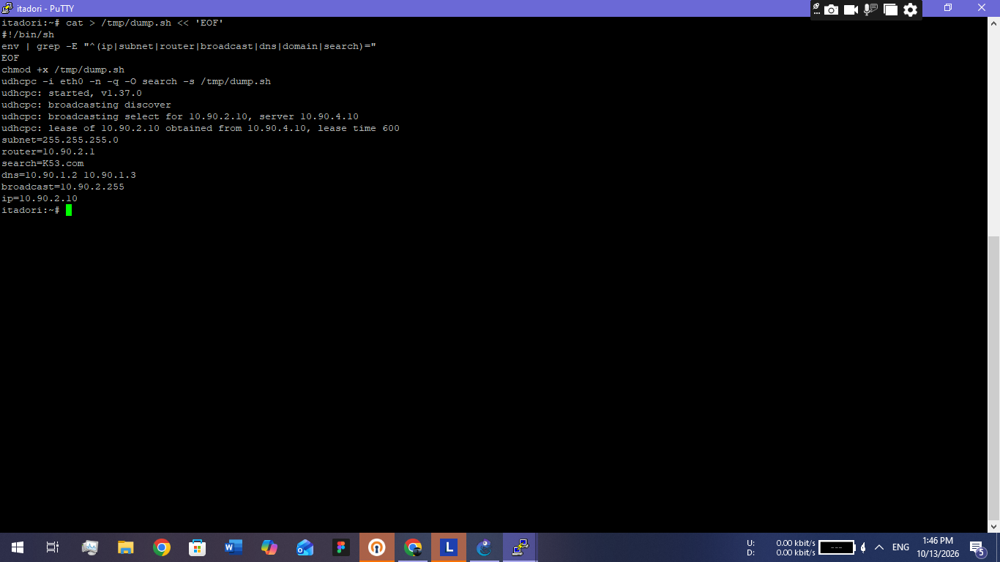

ino (Network 3) : opsi yang diterima `subnet=255.255.255.0`, `router=10.90.3.1`, `search=K53.com`, `dns=10.90.1.2 10.90.1.3`, `broadcast=10.90.3.255`, `ip=10.90.3.10`.


> Pada ino, lease time yang dilaporkan `udhcpc` pada permintaan ini adalah 1599, bukan 1800. Itu karena ino masih memegang lease yang baru dibuat, sehingga yang dilaporkan adalah **sisa** waktu lease yang berjalan. Batas yang diberikan server tetap 1800 detik (lihat permintaan sebelumnya yang menampilkan lease time 1800).

---

#### 3. Mencocokkan lease di tengen

Jalankan di tengen:
```bash
dhcpd -t -cf /etc/dhcp/dhcpd.conf
service isc-dhcp-server status
cat /etc/dhcp/net2.conf /etc/dhcp/net3.conf /etc/dhcp/net3-static.conf
awk '/^lease/{ip=$2} /^  binding state/{st[ip]=$3} /hardware ethernet/{mac[ip]=$3} /^  ends/{e[ip]=$3" "$4} END{for(i in mac) print i, mac[i], st[i], e[i]}' /var/lib/dhcp/dhcpd.leases | sort -V
```

Penjelasan:

| Perintah | Fungsi |
|---|---|
| `dhcpd -t -cf ...` | Memvalidasi konfigurasi tanpa error |
| `service isc-dhcp-server status` | Memastikan dhcpd berjalan |
| `cat net2.conf net3.conf net3-static.conf` | Menampilkan seluruh kebijakan pool, kelas, dan reservasi |
| `awk ... dhcpd.leases \| sort -V` | `dhcpd.leases` bersifat log yang terus bertambah (satu IP bisa muncul berkali-kali). `awk` merangkumnya menjadi satu baris per IP dengan MAC, status, dan waktu `ends` terbaru (waktu mengikuti jam server, UTC) |

##### Bukti :
tengen :
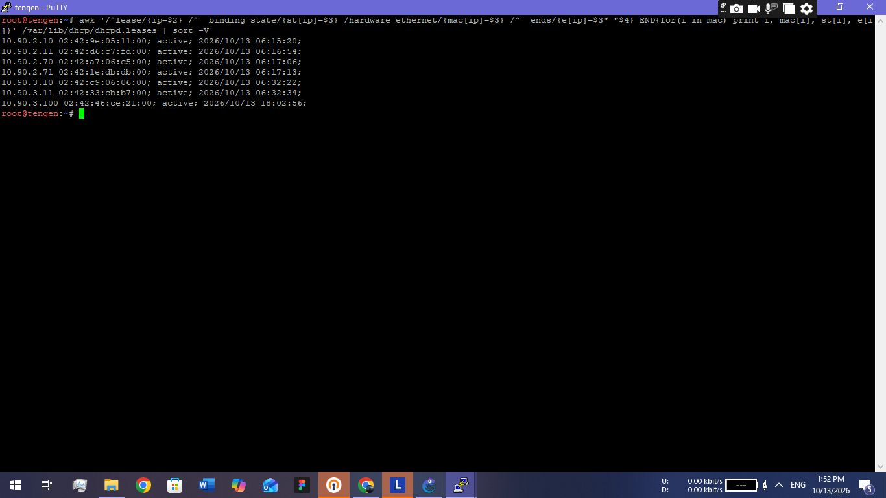

Hasil di atas sesuai harapan: validasi konfigurasi lolos tanpa error, `dhcpd is running`, dan isi tiga file konfigurasi sesuai kebijakan Soal 4, 5, dan 6.

Pencocokan lease dengan client:

| IP | MAC address | Client | Pool / kelas | Di dalam kebijakan? |
|---|---|---|---|---|
| 10.90.2.10 | `02:42:9e:05:11:00` | itadori | Pool 1 (10 - 35) | Ya |
| 10.90.2.11 | `02:42:d6:c7:fd:00` | fushiguro | Pool 1 (10 - 35) | Ya |
| 10.90.2.70 | `02:42:a7:06:c5:00` | zenin | Pool 2 (70 - 95) | Ya |
| 10.90.2.71 | `02:42:1e:db:db:00` | okkotsu | Pool 2 (70 - 95) | Ya |
| 10.90.3.10 | `02:42:c9:06:06:00` | ino | short (10 - 89) | Ya |
| 10.90.3.11 | `02:42:33:cb:b7:00` | kusakabe | short (10 - 89) | Ya |
| 10.90.3.100 | `02:42:46:ce:21:00` | miwa | long (100 - 199) | Ya |
| 10.90.3.99 | `02:42:59:c7:e6:00` | kugisaki | `host kugisaki` (fixed-address) | Ya |

Pemeriksaan kebijakan:

| Pemeriksaan | Hasil |
|---|---|
| Tabrakan alamat | Tidak ada. Tujuh lease dinamis memakai tujuh IP berbeda dan tujuh MAC berbeda |
| Alamat di luar pool | Tidak ada. Tidak satu pun IP berada di `10.90.2.36 - 10.90.2.69` maupun `10.90.3.90 - 10.90.3.98` |
| Kugisaki | `10.90.3.99` berasal dari reservasi `fixed-address` di `net3-static.conf` dan berada di luar pool short dan long. Pada `dhcpd.leases` host dengan `fixed-address` tidak dicatat sebagai lease dinamis, sehingga kugisaki tidak muncul pada ringkasan `awk` |

> Jika node di-stop lalu di-start lagi, konfigurasi IP hilang dan paket yang terpasang bisa ikut hilang. Jalankan ulang script pemulihan sesuai urutan: `bash /root/jichi.sh`, `bash /root/tengen.sh`, `bash /root/tengen-dhcp.sh`, `bash /root/tengen-net2.sh`, `bash /root/tengen-net3.sh`, `bash /root/tengen-kugisaki.sh`, lalu `bash /root/jichi-relay.sh`.

---

### Soal 8 : Packet Capture Proses DHCP (tcpdump di tengen)

Sebelum Curtain dibuka kembali, pada soal ini dibuktikan bahwa proses pemberian alamat berjalan sesuai protokol DHCP. Dilakukan packet capture dengan **tcpdump** di **tengen** saat client Network 2 (itadori) dan client Network 3 (ino) meminta lease baru. Dari capture ditunjukkan urutan **DISCOVER → OFFER → REQUEST → ACK**, beserta alamat server, alamat yang diberikan, lease time, dan field **giaddr**.

#### Persiapan

Pasang tcpdump di tengen:
```bash
apt update; apt install -y tcpdump
tcpdump --version
```

> Dengan jalur relay, paket dari client tidak sampai ke tengen sebagai broadcast. jichi meneruskannya secara unicast dari `10.90.4.1` ke `10.90.4.10`, dan mengisi field **giaddr** dengan alamat interface jichi yang menerima request dari client.

---

#### 1. Capture Network 2 (itadori)

Buka dua konsol. Di **tengen** jalankan capture lebih dulu (berhenti sendiri setelah 4 paket):
```bash
tcpdump -i eth0 -n -vvv -c 4 'udp and (port 67 or port 68)'
```
Setelah tengen menunggu, di **itadori** minta lease baru:
```bash
killall udhcpc 2>/dev/null
ip addr flush dev eth0
ip link set eth0 up
udhcpc -i eth0
ip -br addr
```

Penjelasan opsi tcpdump:

| Opsi | Fungsi |
|---|---|
| `-i eth0` | Capture di interface tengen yang berada di Network 4 |
| `-n` | Tidak me-resolve nama, alamat IP tampil apa adanya |
| `-vvv` | Menampilkan detail BOOTP/DHCP: `Gateway-IP` (giaddr), `Your-IP`, `Server-ID`, `Lease-Time` |
| `-c 4` | Berhenti setelah 4 paket (DISCOVER, OFFER, REQUEST, ACK) |
| `'udp and (port 67 or port 68)'` | Hanya lalu lintas DHCP |

##### Bukti :
tengen (DISCOVER dan OFFER) :
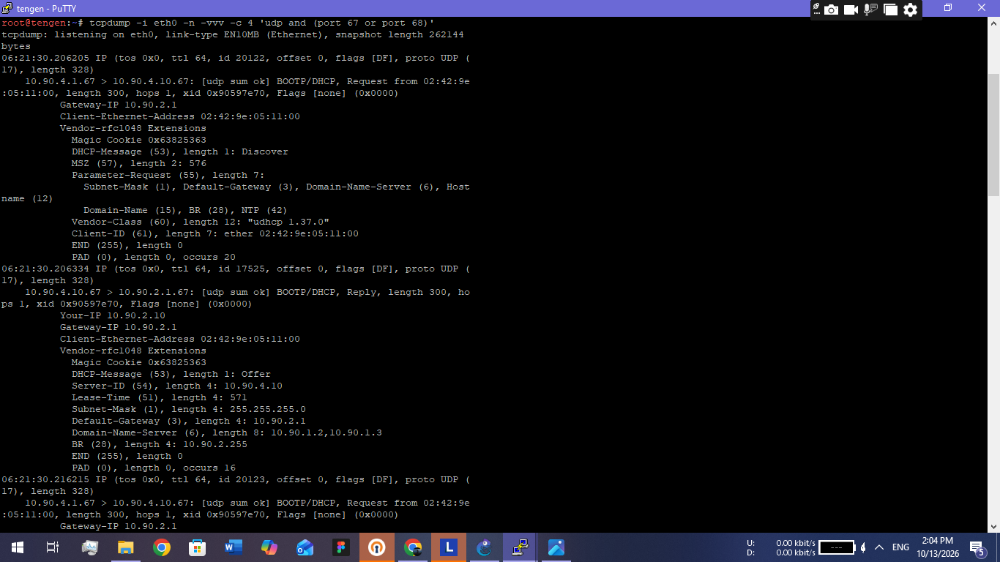

tengen (REQUEST dan ACK, serta ringkasan `4 packets captured`) :
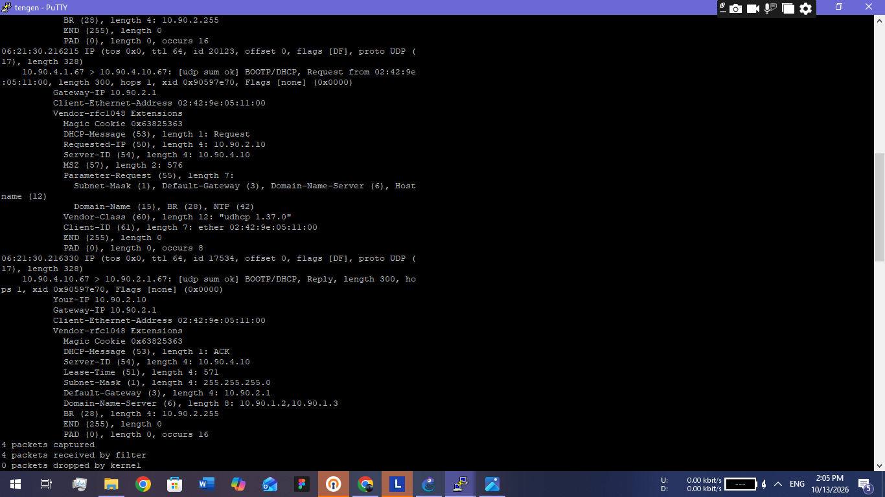

itadori (hasil `udhcpc`) :
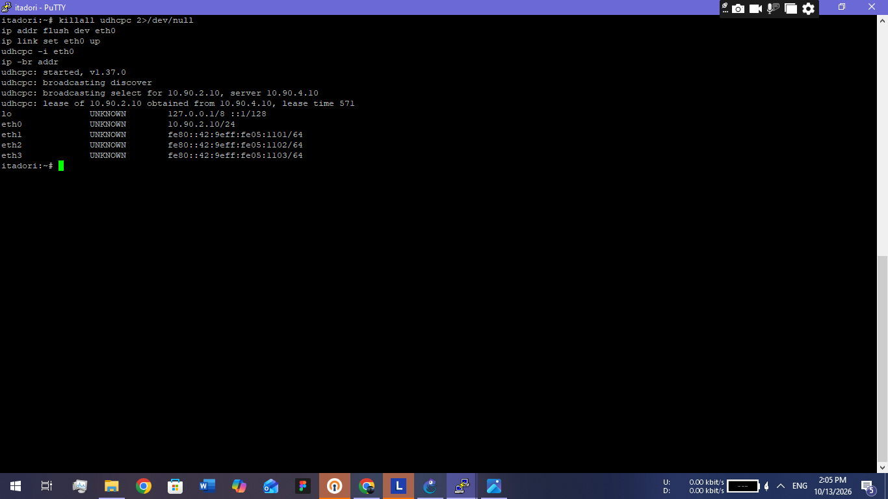

Urutan paket pada capture Network 2 (`xid 0x90597e70`, client MAC `02:42:9e:05:11:00`):

| No | Waktu | Arah | Tipe pesan (opsi 53) | Isi penting |
|---|---|---|---|---|
| 1 | 06:21:30.206205 | 10.90.4.1 → 10.90.4.10 | **Discover** | `Gateway-IP 10.90.2.1`, hops 1, Client-ID `02:42:9e:05:11:00` |
| 2 | 06:21:30.206334 | 10.90.4.10 → 10.90.2.1 | **Offer** | `Your-IP 10.90.2.10`, `Server-ID 10.90.4.10`, `Lease-Time 571`, mask `255.255.255.0`, gateway `10.90.2.1`, DNS `10.90.1.2,10.90.1.3`, broadcast `10.90.2.255` |
| 3 | 06:21:30.216215 | 10.90.4.1 → 10.90.4.10 | **Request** | `Requested-IP 10.90.2.10`, `Server-ID 10.90.4.10`, `Gateway-IP 10.90.2.1` |
| 4 | 06:21:30.216330 | 10.90.4.10 → 10.90.2.1 | **ACK** | `Your-IP 10.90.2.10`, `Server-ID 10.90.4.10`, `Lease-Time 571` |

Keempat paket memakai `xid` yang sama, sehingga terbukti merupakan satu transaksi DHCP.

---

#### 2. Capture Network 3 (ino)

Ulangi dengan cara yang sama. Di **tengen**:
```bash
tcpdump -i eth0 -n -vvv -c 4 'udp and (port 67 or port 68)'
```
Lalu di **ino**:
```bash
killall udhcpc 2>/dev/null
ip addr flush dev eth0
ip link set eth0 up
udhcpc -i eth0
ip -br addr
```

##### Bukti :
tengen (DISCOVER, OFFER, dan awal REQUEST) :
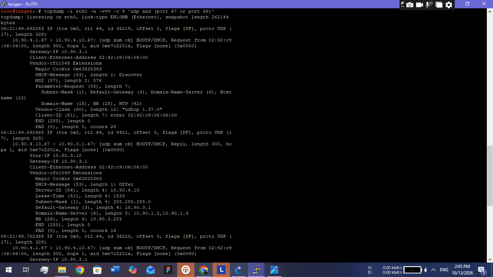

tengen (REQUEST dan ACK, serta ringkasan `4 packets captured`) :
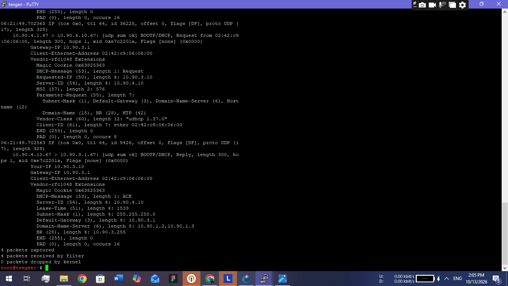

ino (hasil `udhcpc`) :
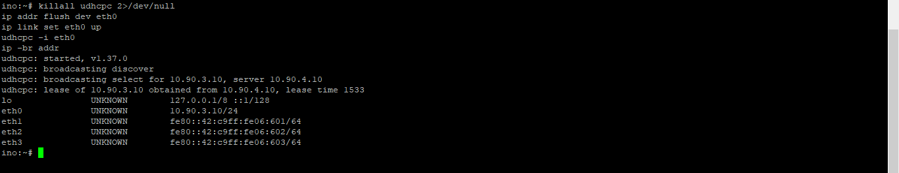

Urutan paket pada capture Network 3 (`xid 0xe7c2201a`, client MAC `02:42:c9:06:06:00`):

| No | Waktu | Arah | Tipe pesan (opsi 53) | Isi penting |
|---|---|---|---|---|
| 1 | 06:21:49.692263 | 10.90.4.1 → 10.90.4.10 | **Discover** | `Gateway-IP 10.90.3.1`, hops 1, Client-ID `02:42:c9:06:06:00` |
| 2 | 06:21:49.692465 | 10.90.4.10 → 10.90.3.1 | **Offer** | `Your-IP 10.90.3.10`, `Server-ID 10.90.4.10`, `Lease-Time 1533`, mask `255.255.255.0`, gateway `10.90.3.1`, DNS `10.90.1.2,10.90.1.3`, broadcast `10.90.3.255` |
| 3 | 06:21:49.702365 | 10.90.4.1 → 10.90.4.10 | **Request** | `Requested-IP 10.90.3.10`, `Server-ID 10.90.4.10`, `Gateway-IP 10.90.3.1` |
| 4 | 06:21:49.702563 | 10.90.4.10 → 10.90.3.1 | **ACK** | `Your-IP 10.90.3.10`, `Server-ID 10.90.4.10`, `Lease-Time 1533` |

---

#### 3. Identifikasi hasil capture

| Informasi | Network 2 (itadori) | Network 3 (ino) |
|---|---|---|
| Alamat server DHCP (`Server-ID`) | 10.90.4.10 (tengen) | 10.90.4.10 (tengen) |
| Alamat yang diberikan (`Your-IP`) | 10.90.2.10 | 10.90.3.10 |
| Lease time | 571 detik | 1533 detik |
| `giaddr` (`Gateway-IP`) | 10.90.2.1 | 10.90.3.1 |
| Interface jichi yang menerima request | eth2 (10.90.2.1) | eth3 (10.90.3.1) |
| Sumber paket yang sampai ke tengen | 10.90.4.1 (eth4 jichi) | 10.90.4.1 (eth4 jichi) |
| Tujuan balasan dari tengen | 10.90.2.1 (giaddr) | 10.90.3.1 (giaddr) |

Kesimpulan:
- **Urutan protokol benar.** Pada kedua capture muncul empat pesan berurutan: Discover, Offer, Request, ACK, dengan `xid` yang konsisten dalam satu transaksi.
- **giaddr sesuai interface jichi.** Request dari Network 2 membawa `giaddr 10.90.2.1` (alamat eth2 jichi), dan request dari Network 3 membawa `giaddr 10.90.3.1` (alamat eth3 jichi). Berdasarkan `giaddr` inilah tengen memilih scope yang cocok (`net2.conf` atau `net3.conf`) dan mengirim balasan unicast kembali ke alamat relay tersebut.
- **Relay bekerja.** Semua paket yang sampai ke tengen berasal dari `10.90.4.1` dan memiliki `hops 1`, yang menandakan paket telah diteruskan satu kali oleh relay di jichi.
- **Alamat sesuai kebijakan.** itadori memperoleh `10.90.2.10` dari Pool 1, dan ino memperoleh `10.90.3.10` dari pool short lease. Opsi gateway, DNS, mask, dan broadcast pada Offer dan ACK sesuai dengan masing-masing network.

> Lease time pada capture adalah 571 dan 1533, bukan 600 dan 1800. Ini karena kedua client masih memegang lease yang sebelumnya dibuat dan belum habis, sehingga yang ditawarkan adalah **sisa** waktu lease tersebut. Batas lease dari kebijakan server tetap 600 detik (Pool 1 / Network 2) dan 1800 detik (short lease / Network 3), sesuai Soal 4 dan Soal 5.

---

### Soal 9 : Gangguan Jalur Relay dan Pemulihannya (jichi)

Sebuah gangguan memutus jalur relay sehingga permintaan alamat tidak sampai ke Data Center. Pada soal ini service **DHCP Relay** di **jichi** dihentikan, lalu client Network 2 (itadori) dipaksa meminta lease baru dan gejalanya dicatat. Setelah itu relay dipulihkan, permintaan DHCP diulang, dan dibuktikan bahwa client kembali memperoleh alamat dari pool yang benar dengan gateway semula.

#### Alur pengujian

| Tahap | Node | Tindakan | Hasil yang diharapkan |
|---|---|---|---|
| 1 | jichi | Hentikan service relay | Proses relay berhenti |
| 2 | tengen | Jalankan tcpdump selama 15 detik | Tidak ada paket DHCP yang tiba |
| 3 | itadori | Minta lease baru | Gagal memperoleh lease, tanpa IP dan gateway |
| 4 | jichi | Jalankan kembali service relay | Proses `dhcrelay` berjalan |
| 5 | itadori | Minta lease baru | Memperoleh IP Pool 1 dan gateway `10.90.2.1` |

> Client yang dipakai adalah itadori (Network 2, Pool 1 `10.90.2.10 - 10.90.2.35`, gateway `10.90.2.1`).

---

#### 1. Hentikan relay (jichi)

Buka konsol jichi, lalu jalankan:
```bash
service isc-dhcp-relay stop
service isc-dhcp-relay status
ps aux | grep [d]hcrelay
```

##### Bukti :
jichi :
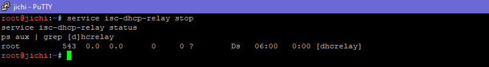

Relay sudah dihentikan. Pada `ps` hanya tersisa entri `[dhcrelay]` dengan ukuran memori 0 dan tanpa command line `/usr/sbin/dhcrelay ...`. Itu adalah sisa proses yang sudah berakhir, bukan relay yang masih berjalan. Matinya fungsi relay dibuktikan lebih lanjut oleh tengen dan itadori pada langkah berikutnya.

---

#### 2. Capture di tengen saat relay mati

Jalankan di tengen, lalu segera lakukan langkah 3 di itadori selama capture berjalan:
```bash
timeout 15 tcpdump -i eth0 -n 'udp and (port 67 or port 68)'
```

Penjelasan:

| Bagian | Fungsi |
|---|---|
| `timeout 15` | Menghentikan capture otomatis setelah 15 detik |
| `-i eth0` | Capture di interface tengen pada Network 4 |
| `-n` | Alamat IP tampil apa adanya tanpa resolve nama |
| `'udp and (port 67 or port 68)'` | Hanya lalu lintas DHCP |

##### Bukti :
tengen :
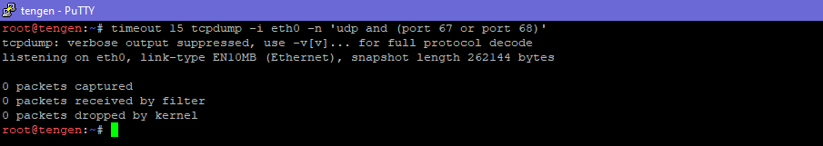

Capture selesai dengan `0 packets captured`: tidak ada satu pun paket DHCP yang sampai ke tengen. Ini membuktikan bahwa permintaan dari client Network 2 tidak diteruskan ke Data Center.

---

#### 3. Client meminta lease saat relay mati (itadori)

```bash
killall udhcpc 2>/dev/null
ip addr flush dev eth0
ip link set eth0 up
udhcpc -i eth0 -n -t 3 -T 2
ip -br addr
ip route
ping -c 2 10.90.4.10
```

Penjelasan:

| Perintah | Fungsi |
|---|---|
| `ip addr flush dev eth0` | Membuang IP lama supaya client benar-benar tanpa alamat |
| `udhcpc -i eth0 -n -t 3 -T 2` | Mengirim 3 kali DISCOVER dengan jeda 2 detik, lalu keluar bila tidak ada jawaban (`-n`) |
| `ip -br addr`, `ip route` | Memeriksa IP dan routing setelah percobaan |
| `ping -c 2 10.90.4.10` | Menguji jangkauan ke tengen |

##### Bukti :
itadori :
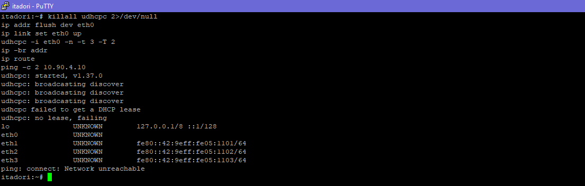

Gejala yang tercatat:

| Gejala | Keterangan |
|---|---|
| `udhcpc: broadcasting discover` muncul 3 kali | Client terus mengirim DISCOVER tetapi tidak ada OFFER yang kembali |
| `udhcpc: failed to get a DHCP lease` dan `no lease, failing` | Permintaan lease gagal |
| `eth0` tanpa alamat IPv4 | Hanya interface lain yang memiliki alamat link-local IPv6 |
| `ip route` kosong | Tidak ada default gateway maupun route jaringan lokal |
| `ping: connect: Network unreachable` | Client tidak dapat menjangkau tengen |

Penyebabnya: DHCPDISCOVER dikirim secara broadcast dan tidak dapat menyeberangi subnet. Tanpa relay di jichi, broadcast dari Network 2 tidak pernah diteruskan ke tengen di Network 4 (terbukti dari capture yang kosong), sehingga tidak ada OFFER yang kembali.

---

#### 4. Pulihkan relay (jichi)

```bash
service isc-dhcp-relay start
service isc-dhcp-relay status
ps aux | grep [d]hcrelay
```

##### Bukti :
jichi :
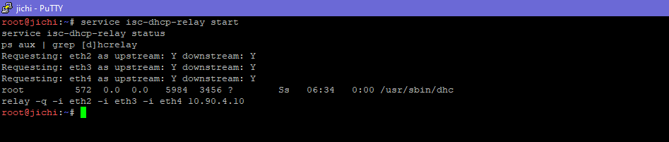

Relay berjalan kembali dengan proses `/usr/sbin/dhcrelay -q -i eth2 -i eth3 -i eth4 10.90.4.10`, sama seperti konfigurasi pada Soal 3. Tiga baris `Requesting: eth2/eth3/eth4 as upstream: Y downstream: Y` menunjukkan relay mendaftarkan ketiga interface.

---

#### 5. Ulangi permintaan DHCP setelah pulih (itadori)

```bash
killall udhcpc 2>/dev/null
ip addr flush dev eth0
ip link set eth0 up
udhcpc -i eth0
ip -br addr
ip route
cat /etc/resolv.conf
ping -c 3 10.90.4.10
```

##### Bukti :
itadori :
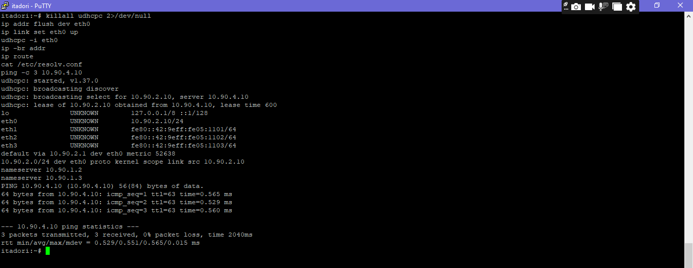

Hasil setelah relay dipulihkan:

| Pemeriksaan | Sebelum (relay mati) | Sesudah (relay pulih) |
|---|---|---|
| Lease | `no lease, failing` | `10.90.2.10` dari server `10.90.4.10`, lease time 600 |
| IP eth0 | Tidak ada | `10.90.2.10/24` (Pool 1: 10.90.2.10 - 10.90.2.35) |
| Default gateway | Tidak ada | `default via 10.90.2.1 dev eth0` |
| DNS | - | `10.90.1.2` dan `10.90.1.3` |
| Ping ke tengen (`10.90.4.10`) | `Network is unreachable` | 3 terkirim, 3 diterima, 0% loss, TTL 63 |

itadori kembali memperoleh alamat dari pool yang benar (Pool 1) dengan gateway semula `10.90.2.1`. TTL 63 menandakan paket melewati satu router (jichi).

> Jika jichi di-stop lalu di-start lagi, konfigurasi IP hilang dan relay tidak berjalan. Jalankan ulang `bash /root/jichi.sh`, lalu `bash /root/jichi-relay.sh`.

---

### Soal 10 : Autostart DHCP Server (tengen) dan DHCP Relay (jichi), Restart Node, dan Verifikasi

Setelah gangguan Shibuya tertangani, pemulihan harus **bertahan setelah restart**. Pada soal ini autostart diaktifkan untuk **DHCP Server** di **tengen** dan **DHCP Relay** di **jichi**, kedua node di-restart, lalu diverifikasi status layanan, IP, gateway, lease, dan konektivitas client Network 2 dan 3. Kebijakan Pool 1, Pool 2, short lease, long lease, dan fixed address harus tetap berlaku.

#### Gambaran pengerjaan

| Tahap | Tindakan | Hasil |
|---|---|---|
| 1 | Aktifkan autostart dengan `update-rc.d` dan restart tengen serta jichi | Paket dan konfigurasi selamat, tetapi IP dan service **tidak** hidup sendiri |
| 2 | Telusuri penyebab dan pasang konfigurasi boot lewat `/etc/network/interfaces` | IP, NAT, forwarding, dan kedua service dijalankan saat interface naik |
| 3 | Restart tengen dan jichi tanpa menjalankan script apa pun | Semua pulih otomatis |
| 4 | Verifikasi client Network 2 dan 3 serta lease di tengen | Seluruh kebijakan tetap berlaku |

---

#### 1. Aktifkan autostart dan restart (percobaan pertama)

Di **tengen**:
```bash
update-rc.d isc-dhcp-server defaults
update-rc.d isc-dhcp-server enable
ls /etc/rc2.d/ | grep dhcp
grep INTERFACES /etc/default/isc-dhcp-server
ls /root/*.sh
```
Di **jichi**:
```bash
update-rc.d isc-dhcp-relay defaults
update-rc.d isc-dhcp-relay enable
ls /etc/rc2.d/ | grep dhcp
cat /etc/default/isc-dhcp-relay
ls /root/*.sh
```

Penjelasan:

| Perintah | Fungsi |
|---|---|
| `update-rc.d <service> defaults` | Membuat link autostart (`S01...`) pada runlevel standar di `/etc/rc2.d` |
| `update-rc.d <service> enable` | Memastikan service ditandai aktif |
| `ls /etc/rc2.d/ \| grep dhcp` | Memeriksa link autostart: `S01isc-dhcp-server` di tengen dan `S01isc-dhcp-relay` di jichi |
| `grep INTERFACES` dan `cat /etc/default/isc-dhcp-relay` | Memastikan `INTERFACESv4="eth0"` di tengen, serta `SERVERS="10.90.4.10"` dan `INTERFACES="eth2 eth3 eth4"` di jichi |

Link `S01isc-dhcp-server` (tengen) dan `S01isc-dhcp-relay` (jichi) terlihat pada keluaran `ls /etc/rc2.d/ | grep dhcp` di bukti bagian 2.

Setelah itu tengen dan jichi di-restart lewat GNS3 (klik kanan node, **Stop**, lalu **Start**), dan kondisinya diperiksa **tanpa** menjalankan script apa pun:
```bash
ip -br addr
ip route
which dhcpd              # di tengen (di jichi: which dhcrelay)
ls /etc/dhcp             # di tengen
ps aux | grep [d]hcpd    # di jichi: ps aux | grep [d]hcrelay
service isc-dhcp-server status   # di jichi: service isc-dhcp-relay status
ls /root/*.sh
```

Hasil pengamatan setelah restart pertama:

| Item | tengen | jichi |
|---|---|---|
| IP dan route | Hilang (hanya alamat link-local) | Hilang, aturan NAT `MASQUERADE` juga kosong |
| Paket | Ada (`/usr/sbin/dhcpd`) | Ada (`/usr/sbin/dhcrelay`) |
| Konfigurasi | Ada (`dhcpd.conf`, `net2.conf`, `net3.conf`, `net3-static.conf`) | Ada (`/etc/default/isc-dhcp-relay`) |
| Link `S01...` di `/etc/rc2.d` | Ada | Ada |
| Service | **Tidak berjalan** (`not running but /var/run/dhcpd.pid exists`) | **Tidak berjalan** (tidak ada proses `dhcrelay`) |
| Script di `/root` | Ada | Ada |

Kesimpulan percobaan pertama: paket, konfigurasi, dan script **selamat** setelah restart, tetapi IP, NAT, dan service **tidak otomatis hidup**, meskipun link `S01...` sudah ada. Pada node ini proses pertama (PID 1) adalah `dumb-init` dan bukan init system penuh, sehingga link di `/etc/rc2.d` tidak cukup untuk memicu service saat boot.

---

#### 2. Konfigurasi boot lewat `/etc/network/interfaces`

Berkas `/etc/network/interfaces` pada kedua node awalnya hanya berisi template yang seluruhnya dikomentari. Berkas ini memakai pola `up <perintah>`, yaitu perintah yang dijalankan otomatis setiap interface naik. Pola ini dipakai untuk menerapkan IP statis sekaligus menjalankan perintah yang sebelumnya manual.

Di **tengen**:
```bash
cp /etc/network/interfaces /root/interfaces.bak
cat > /etc/network/interfaces << 'EOF'
auto eth0
iface eth0 inet static
    address 10.90.4.10
    netmask 255.255.255.0
    gateway 10.90.4.1
    up echo "nameserver 192.168.122.1" > /etc/resolv.conf
    up (rm -f /var/run/dhcpd.pid; service isc-dhcp-server start) || true
EOF
```
Di **jichi**:
```bash
cp /etc/network/interfaces /root/interfaces.bak
cat > /etc/network/interfaces << 'EOF'
auto eth0
iface eth0 inet static
    address 192.168.122.153
    netmask 255.255.255.0
    gateway 192.168.122.1
    up echo "nameserver 192.168.122.1" > /etc/resolv.conf
    up sysctl -w net.ipv4.ip_forward=1 || true
    up (iptables -t nat -F POSTROUTING; iptables -t nat -A POSTROUTING -o eth0 -s 10.90.0.0/16 -j MASQUERADE) || true

auto eth1
iface eth1 inet static
    address 10.90.1.1
    netmask 255.255.255.0

auto eth2
iface eth2 inet static
    address 10.90.2.1
    netmask 255.255.255.0

auto eth3
iface eth3 inet static
    address 10.90.3.1
    netmask 255.255.255.0

auto eth4
iface eth4 inet static
    address 10.90.4.1
    netmask 255.255.255.0
    up (service isc-dhcp-relay start) || true
EOF
```

Penjelasan:

| Bagian | Fungsi |
|---|---|
| `auto ethX` dan `iface ethX inet static` | Interface dinaikkan otomatis saat boot dengan IP statis sesuai rancangan (Soal 1) |
| `up echo "nameserver 192.168.122.1" > /etc/resolv.conf` | Resolver sementara untuk akses internet |
| `up sysctl -w net.ipv4.ip_forward=1` (jichi) | Mengaktifkan IPv4 forwarding saat boot |
| `up (iptables ... MASQUERADE)` (jichi) | Memasang kembali source NAT saat boot |
| `up (rm -f /var/run/dhcpd.pid; service isc-dhcp-server start)` (tengen) | Membuang pid file basi lalu menjalankan DHCP server setelah eth0 punya IP |
| `up (service isc-dhcp-relay start)` pada `eth4` (jichi) | Menjalankan relay terakhir, setelah eth2, eth3, dan eth4 sudah naik |
| `\|\| true` | Kegagalan satu perintah tidak membatalkan proses naiknya interface |
| `/root/interfaces.bak` | Cadangan template asli. Kembalikan dengan `cp /root/interfaces.bak /etc/network/interfaces` bila perlu |

##### Bukti :
tengen (`/etc/network/interfaces` dan link autostart `S01isc-dhcp-server`) :
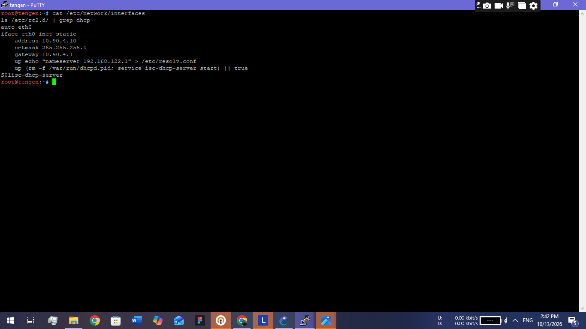

jichi (`/etc/network/interfaces` dan link autostart `S01isc-dhcp-relay`) :
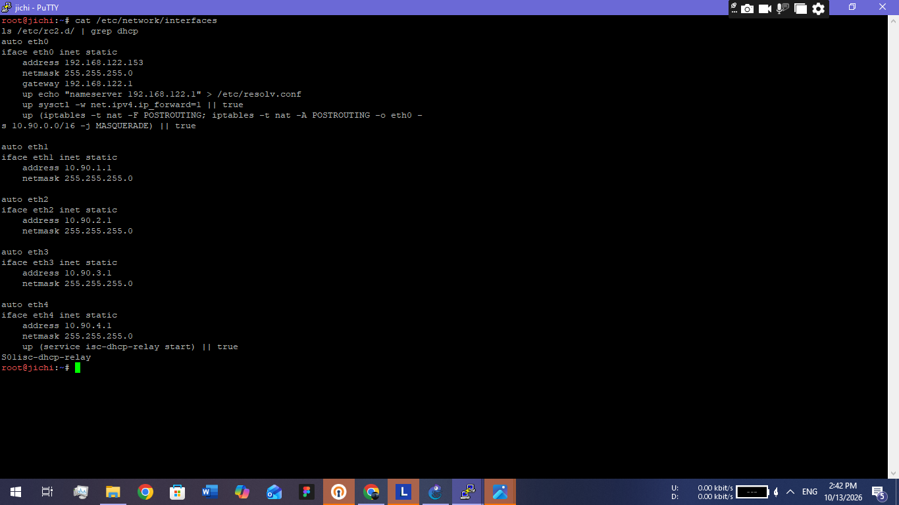

---

#### 3. Restart kedua dan verifikasi layanan

tengen dan jichi di-restart lagi lewat GNS3, lalu diperiksa **tanpa menjalankan script apa pun**:

Di **tengen**:
```bash
ip -br addr
ip route
ps aux | grep [d]hcpd
service isc-dhcp-server status
```
Di **jichi**:
```bash
ip -br addr
ip route
sysctl net.ipv4.ip_forward
iptables -t nat -L POSTROUTING -n
ps aux | grep [d]hcrelay
```

Hasil pengamatan setelah restart kedua:

| Item | tengen | jichi |
|---|---|---|
| IP | `eth0` 10.90.4.10/24 | `eth0` 192.168.122.153/24, `eth1` - `eth4` 10.90.1.1 - 10.90.4.1 (/24) |
| Default route | via 10.90.4.1 | via 192.168.122.1 |
| IPv4 forwarding | - | `net.ipv4.ip_forward = 1` |
| NAT | - | `MASQUERADE` untuk `10.90.0.0/16` |
| Service | `dhcpd is running` (`/usr/sbin/dhcpd -4 -q -cf /etc/dhcp/dhcpd.conf eth0`) | `/usr/sbin/dhcrelay -q -i eth2 -i eth3 -i eth4 10.90.4.10` berjalan |
| Waktu mulai proses | PID 87, mulai 06:55 | PID 94, mulai 06:55 |

IP, NAT, forwarding, dan kedua service hidup sendiri setelah restart tanpa campur tangan manual. PID yang kecil dengan waktu mulai yang baru menunjukkan kedua proses lahir dari proses boot, bukan sisa sesi sebelumnya. Keberhasilan ini juga terlihat dari kedelapan client pada bagian berikut yang langsung memperoleh lease lewat relay dan dapat mengakses internet lewat NAT.

---

#### 4. Verifikasi client Network 2 dan 3

Jalankan di kedelapan client (itadori, fushiguro, zenin, okkotsu, ino, kusakabe, miwa, kugisaki):
```bash
killall udhcpc 2>/dev/null
ip addr flush dev eth0
ip link set eth0 up
udhcpc -i eth0
ip -br addr
ip route
cat /etc/resolv.conf
ping -c 3 10.90.4.10
ping -c 3 8.8.8.8
```

Penjelasan:

| Perintah | Fungsi |
|---|---|
| `udhcpc -i eth0` | Meminta lease baru lewat relay jichi menuju tengen |
| `ip -br addr`, `ip route`, `cat /etc/resolv.conf` | Memeriksa IP, gateway, dan DNS |
| `ping -c 3 10.90.4.10` | Menguji jalur ke tengen lewat jichi (TTL 63 = satu router) |
| `ping -c 3 8.8.8.8` | Menguji NAT di jichi setelah restart (TTL 111 menandakan paket kembali dari internet) |

##### Bukti :
**Divisi A (Network 2)**

itadori :
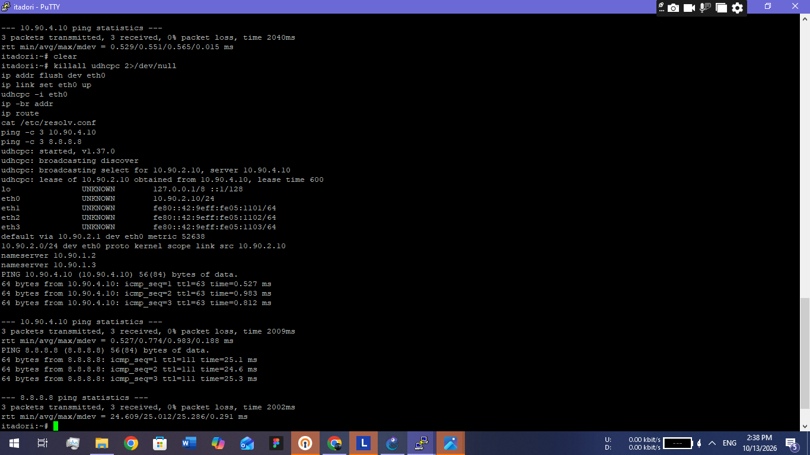

fushiguro :
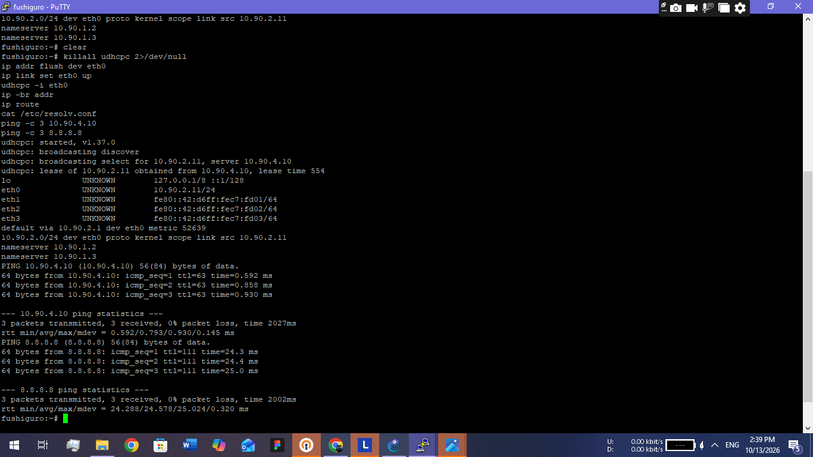

zenin :


okkotsu :


**Divisi B (Network 3)**

ino :
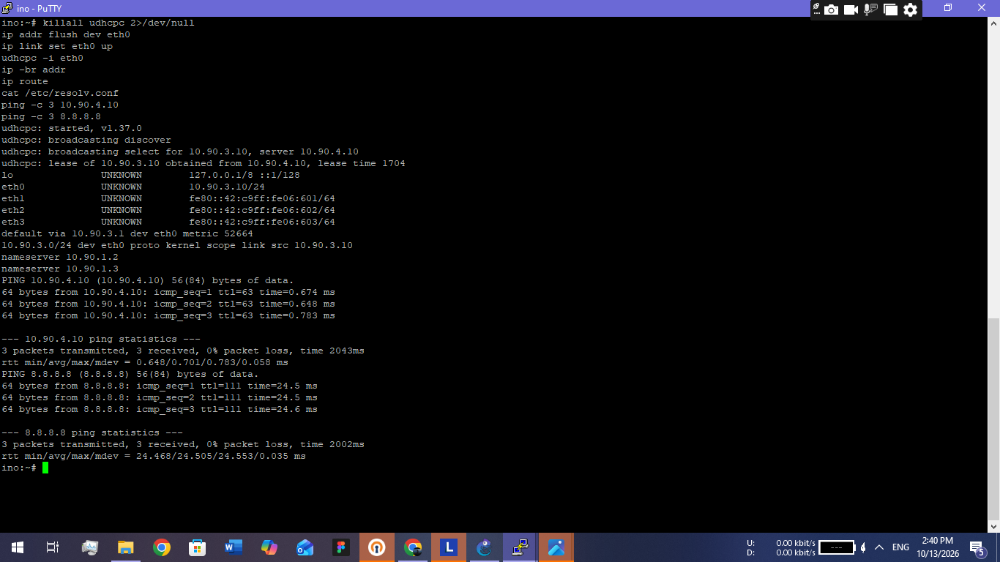

kusakabe :


miwa :


kugisaki :
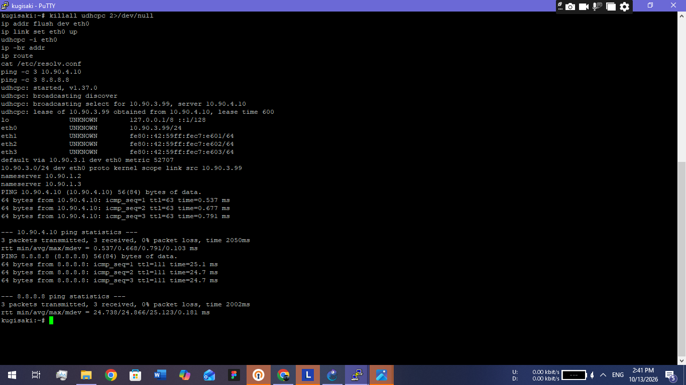

Ringkasan hasil:

| Client | Pool / kelas | IP | Gateway | Lease time | Ping tengen | Ping 8.8.8.8 |
|---|---|---|---|---|---|---|
| itadori | Pool 1 | 10.90.2.10 | 10.90.2.1 | 600 | 0% loss, TTL 63 | 0% loss, TTL 111 |
| fushiguro | Pool 1 | 10.90.2.11 | 10.90.2.1 | 554 | 0% loss, TTL 63 | 0% loss, TTL 111 |
| zenin | Pool 2 | 10.90.2.70 | 10.90.2.1 | 542 | 0% loss, TTL 63 | 0% loss, TTL 111 |
| okkotsu | Pool 2 | 10.90.2.71 | 10.90.2.1 | 528 | 0% loss, TTL 63 | 0% loss, TTL 111 |
| ino | short | 10.90.3.10 | 10.90.3.1 | 1704 | 0% loss, TTL 63 | 0% loss, TTL 111 |
| kusakabe | short | 10.90.3.11 | 10.90.3.1 | 1800 | 0% loss, TTL 63 | 0% loss, TTL 111 |
| miwa | long | 10.90.3.100 | 10.90.3.1 | 39808 | 0% loss, TTL 63 | 0% loss, TTL 111 |
| kugisaki | fixed address | 10.90.3.99 | 10.90.3.1 | 600 | 0% loss, TTL 63 | 0% loss, TTL 111 |

DNS di semua client: `10.90.1.2` dan `10.90.1.3`.

> Beberapa lease time lebih kecil dari batasnya (misalnya 554, 542, 528, 1704, dan 39808) karena client masih memegang lease sebelumnya yang belum habis, sehingga yang dilaporkan adalah **sisa** waktu lease. Batas kebijakan tetap 600 detik untuk Network 2 dan kugisaki, 1800 detik untuk short lease, dan 43200 detik untuk long lease.

---

#### 5. Verifikasi kebijakan di tengen

```bash
dhcpd -t -cf /etc/dhcp/dhcpd.conf
service isc-dhcp-server status
cat /etc/dhcp/net2.conf /etc/dhcp/net3.conf /etc/dhcp/net3-static.conf
awk '/^lease/{ip=$2} /^  binding state/{st[ip]=$3} /hardware ethernet/{mac[ip]=$3} /^  ends/{e[ip]=$3" "$4} END{for(i in mac) print i, mac[i], st[i], e[i]}' /var/lib/dhcp/dhcpd.leases | sort -V
```

##### Bukti :
tengen :
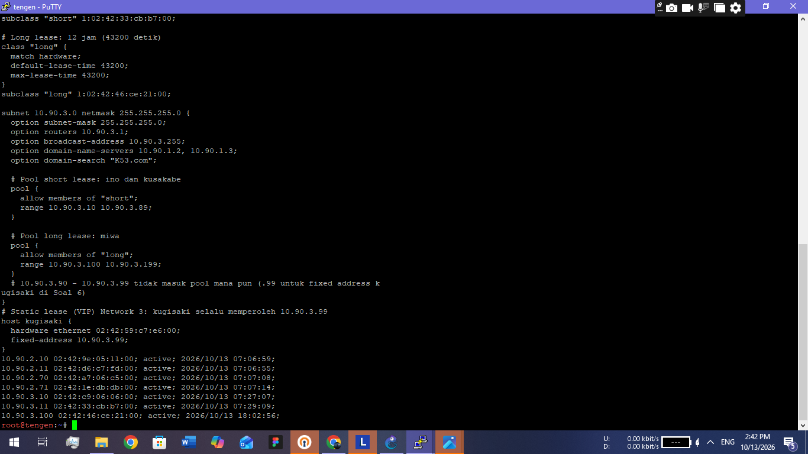

Hasil pada tengen (konfigurasi tetap utuh setelah restart):

| Kebijakan | Bukti |
|---|---|
| Pool 1 (10.90.2.10 - 10.90.2.35) | itadori `10.90.2.10` dan fushiguro `10.90.2.11` berstatus `active` |
| Pool 2 (10.90.2.70 - 10.90.2.95) | zenin `10.90.2.70` dan okkotsu `10.90.2.71` berstatus `active` |
| Short lease (10.90.3.10 - 10.90.3.89, 1800 detik) | Pool short `10.90.3.10 - 10.90.3.89` hanya untuk anggota kelas `short` dengan `default-lease-time 1800` dan `max-lease-time 1800` (MAC ino dan kusakabe). ino `10.90.3.10` dan kusakabe `10.90.3.11` berstatus `active` |
| Long lease (10.90.3.100 - 10.90.3.199, 43200 detik) | Kelas `long` berisi MAC miwa, `default-lease-time 43200`, `max-lease-time 43200`. miwa `10.90.3.100` berstatus `active` |
| Fixed address | `host kugisaki` dengan MAC `02:42:59:c7:e6:00` dan `fixed-address 10.90.3.99`. kugisaki memperoleh `10.90.3.99` |

> kugisaki tidak muncul pada ringkasan `dhcpd.leases` karena host dengan `fixed-address` biasanya tidak dicatat sebagai lease dinamis. Buktinya ada pada blok `host kugisaki` di sisi server dan alamat yang diterima di sisi client.

---

#### Ringkasan

| Yang diminta | Hasil |
|---|---|
| Autostart DHCP Server (tengen) | Aktif. Link `S01isc-dhcp-server` dibuat dan service dijalankan saat boot lewat `/etc/network/interfaces` |
| Autostart DHCP Relay (jichi) | Aktif. Link `S01isc-dhcp-relay` dibuat dan service dijalankan saat boot lewat `/etc/network/interfaces` |
| Restart kedua node | IP, NAT, forwarding, dan kedua service pulih otomatis |
| Status layanan, IP, gateway, lease, konektivitas client | Terverifikasi pada kedelapan client |
| Kebijakan Pool 1, Pool 2, short lease, long lease, fixed address | Tetap berlaku setelah restart |

> Pada node ini link `S01...` di `/etc/rc2.d` saja tidak cukup memulai service saat boot (terbukti pada restart pertama), sehingga pemicunya dipasang di `/etc/network/interfaces`. Jika `interfaces` perlu dikembalikan ke template asli, pakai `/root/interfaces.bak` di masing-masing node.

---

# Laporan Resmi Praktikum Komunikasi Data & Jaringan Komputer 2026 — Modul 3 (Soal 11–20)

**Topik:** Curtain Protocol: Shibuya Incident[cite: 3]  
**Kelompok:** K53[cite: 2]  
**Prefix IP Internal:** `10.90.x.x`[cite: 2]  
**Domain Layanan:** `jujutsu.K53.com`[cite: 2]

---

## Soal 11: Konfigurasi DNS Master (`utahime`) dan DNS Slave (`shoko`)

### 1. Deskripsi & Maksud Soal
Soal ini meminta pembangunan sistem penamaan domain resmi menggunakan **BIND9** agar seluruh pos di jaringan Jujutsu High dapat berkomunikasi menggunakan nama domain `jujutsu.K53.com` tanpa perlu menghafal alamat IP mentah[cite: 2, 3]. Sistem dibangun secara redundan menggunakan arsitektur Master-Slave[cite: 3]:
* **`utahime` (`10.90.1.2`) sebagai DNS Master:** Mengelola file zona utama `jujutsu.K53.com`, memiliki konfigurasi *Start of Authority* (SOA), delegasi *Name Server* (NS) ke kedua server DNS, serta mengizinkan salinan zona (`allow-transfer`) dan pengiriman notifikasi (`notify yes`) ke server Slave[cite: 2, 3].
* **`shoko` (`10.90.1.3`) sebagai DNS Slave:** Menyalin file zona secara otomatis dari Master (`masters { 10.90.1.2; };`) ke dalam direktori `/var/cache/bind/` setiap kali terjadi kenaikan nomor *Serial* pada SOA di `utahime`[cite: 2, 3].

### 2. Output yang Diharapkan
* Service `bind9` / `named` berjalan aktif di `utahime` dan `shoko`[cite: 2].
* File zona berhasil tersinkronisasi otomatis ke `/var/cache/bind/jujutsu.com` pada `shoko`[cite: 2].
* Saat nomor serial di `utahime` dinaikkan dari `2026101401` menjadi `2026101402` dan di-*reload*, nomor serial SOA pada `shoko` ikut terperbarui secara otomatis menjadi `2026101402`[cite: 2, 3].
* Klien (`itadori`) berhasil melakukan query `dig` ke IP `utahime` (`10.90.1.2`) dan `shoko` (`10.90.1.3`) serta mendapatkan daftar kedua NS server[cite: 2, 3].

### 3. Langkah Pengerjaan & Konfigurasi

#### A. Jalankan di `utahime` (DNS Master)[cite: 2]
```bash
cat > /root/utahime-dns.sh << 'EOF'
#!/bin/bash
export DEBIAN_FRONTEND=noninteractive
apt-get update; apt-get install -y bind9 bind9utils bind9-doc dnsutils

# Buat direktori untuk file zona
mkdir -p /etc/bind/jujutsu

# Konfigurasi zona master dan izinkan transfer ke slave (shoko)
cat > /etc/bind/named.conf.local << 'EOT'
zone "jujutsu.K53.com" {
    type master;
    file "/etc/bind/jujutsu/jujutsu.com";
    allow-transfer { 10.90.1.3; };
    notify yes;
};
EOT

# Buat file zona dengan SOA dan NS record
cat > /etc/bind/jujutsu/jujutsu.com << 'EOT'
$TTL    604800
@       IN      SOA     utahime.jujutsu.K53.com. root.jujutsu.K53.com. (
                     2026101401 ; Serial
                         604800 ; Refresh
                          86400 ; Retry
                        2419200 ; Expire
                         604800 ) ; Negative Cache TTL
;
@       IN      NS      utahime.jujutsu.K53.com.
@       IN      NS      shoko.jujutsu.K53.com.
utahime IN      A       10.90.1.2
shoko   IN      A       10.90.1.3
EOT

# Izinkan query dari semua network internal
sed -i 's/listen-on-v6 { any; };/listen-on-v6 { any; };\n\tallow-query { any; };/' /etc/bind/named.conf.options

service bind9 restart
EOF

bash /root/utahime-dns.sh
```

#### B. Jalankan di `shoko` (DNS Slave)[cite: 2]
```bash
cat > /root/shoko-dns.sh << 'EOF'
#!/bin/bash
export DEBIAN_FRONTEND=noninteractive
apt-get update; apt-get install -y bind9 bind9utils bind9-doc dnsutils

# Konfigurasi zona slave, mengambil data dari master (utahime)
cat > /etc/bind/named.conf.local << 'EOT'
zone "jujutsu.K53.com" {
    type slave;
    file "/var/cache/bind/jujutsu.com";
    masters { 10.90.1.2; };
};
EOT

# Izinkan query dari semua network internal
sed -i 's/listen-on-v6 { any; };/listen-on-v6 { any; };\n\tallow-query { any; };/' /etc/bind/named.conf.options

service bind9 restart
EOF

bash /root/shoko-dns.sh
```

*(Catatan: Jika service belum menyala, jalankan `service named restart` dan `service named status` di `utahime` dan `shoko`)*[cite: 2].

### 4. Langkah Pembuktian & Verifikasi

#### A. Verifikasi Sinkronisasi dan Kenaikan Nomor Serial[cite: 2]
1. **Jalankan di `shoko` (Cek file zona dan serial awal):**[cite: 2]
   ```bash
   ls -l /var/cache/bind/
   dig @127.0.0.1 jujutsu.K53.com SOA +short
   ```
2. **Jalankan di `utahime` (Naikkan nomor serial ke `2026101402` dan reload):**[cite: 2]
   ```bash
   sed -i 's/2026101401/2026101402/' /etc/bind/jujutsu/jujutsu.com
   rndc reload
   ```
3. **Jalankan kembali di `shoko` (Pastikan serial sudah terupdate otomatis):**[cite: 2]
   ```bash
   dig @127.0.0.1 jujutsu.K53.com SOA +short
   ```

#### B. Verifikasi Query DNS dari Client (Jalankan di `itadori`)[cite: 2]
```bash
apk add bind-tools

# Query ke Master (utahime)
dig @10.90.1.2 jujutsu.K53.com NS +short

# Query ke Slave (shoko)
dig @10.90.1.3 jujutsu.K53.com NS +short
```

---

## Soal 12: Pemetaan A Record, CNAME, Reverse DNS (PTR), dan DNS Forwarder

### 1. Deskripsi & Maksud Soal
Soal ini meminta perluasan fungsi peta domain agar mampu mengarahkan trafik ke pintu masuk utama sekaligus meneruskan pencarian domain ke internet luar[cite: 3]:
* Membuat **A Record** untuk domain utama `jujutsu.K53.com` dan `gojo` yang mengarah ke alamat IP `gojo` (`10.90.1.4`)[cite: 2, 3].
* Membuat **CNAME Record** untuk subdomain `www` yang merujuk ke domain utama `jujutsu.K53.com.`[cite: 2, 3].
* Membuat **Reverse DNS (Zona PTR)** `1.90.10.in-addr.arpa` untuk melacak balik IP `10.90.1.4` kembali ke nama domain resminya (`jujutsu.K53.com.`)[cite: 2, 3].
* Mengaktifkan **DNS Forwarder** pada BIND9 yang mengarah ke IP gateway internet (`192.168.122.1`) agar klien tetap bisa mengakses domain eksternal seperti `google.com`[cite: 2, 3].

### 2. Output yang Diharapkan
* Query `dig @10.90.1.2 www.jujutsu.K53.com +short` mengembalikan `jujutsu.K53.com.` dan IP `10.90.1.4`[cite: 2].
* Query Reverse DNS `dig @10.90.1.2 -x 10.90.1.4 +short` mengembalikan `jujutsu.K53.com.`[cite: 2].
* Klien (`itadori`) berhasil melakukan `ping -c 3 google.com` tanpa kehilangan paket[cite: 2, 3].

### 3. Langkah Pengerjaan & Konfigurasi

#### A. Jalankan di `utahime`[cite: 2]
```bash
cat > /root/utahime-soal12.sh << 'EOF'
#!/bin/bash

# 1. Update Zona Forward (tambah A record gojo dan CNAME www)
# Serial dinaikkan menjadi 2026101403 agar shoko otomatis update
cat > /etc/bind/jujutsu/jujutsu.com << 'EOT'
$TTL    604800
@       IN      SOA     utahime.jujutsu.K53.com. root.jujutsu.K53.com. (
                     2026101403 ; Serial
                         604800 ; Refresh
                          86400 ; Retry
                        2419200 ; Expire
                         604800 ) ; Negative Cache TTL
;
@       IN      NS      utahime.jujutsu.K53.com.
@       IN      NS      shoko.jujutsu.K53.com.
@       IN      A       10.90.1.4
utahime IN      A       10.90.1.2
shoko   IN      A       10.90.1.3
gojo    IN      A       10.90.1.4
www     IN      CNAME   jujutsu.K53.com.
EOT

# 2. Tambah Zona Reverse ke named.conf.local
cat >> /etc/bind/named.conf.local << 'EOT'

zone "1.90.10.in-addr.arpa" {
    type master;
    file "/etc/bind/jujutsu/1.90.10.in-addr.arpa";
    allow-transfer { 10.90.1.3; };
    notify yes;
};
EOT

# 3. Buat File Zona Reverse (PTR)
cat > /etc/bind/jujutsu/1.90.10.in-addr.arpa << 'EOT'
$TTL    604800
@       IN      SOA     utahime.jujutsu.K53.com. root.jujutsu.K53.com. (
                     2026101401 ; Serial
                         604800 ; Refresh
                          86400 ; Retry
                        2419200 ; Expire
                         604800 ) ; Negative Cache TTL
;
@       IN      NS      utahime.jujutsu.K53.com.
@       IN      NS      shoko.jujutsu.K53.com.
4       IN      PTR     jujutsu.K53.com.
EOT

# 4. Aktifkan DNS Forwarder
cat > /etc/bind/named.conf.options << 'EOT'
options {
        directory "/var/cache/bind";
        forwarders {
                192.168.122.1;
        };
        forward only;
        dnssec-validation auto;
        listen-on-v6 { any; };
        allow-query { any; };
};
EOT

service named restart
EOF

bash /root/utahime-soal12.sh
```

#### B. Jalankan di `shoko`[cite: 2]
```bash
cat > /root/shoko-soal12.sh << 'EOF'
#!/bin/bash

# 1. Tambah Zona Reverse sebagai slave
cat >> /etc/bind/named.conf.local << 'EOT'

zone "1.90.10.in-addr.arpa" {
    type slave;
    file "/var/cache/bind/1.90.10.in-addr.arpa";
    masters { 10.90.1.2; };
};
EOT

# 2. Aktifkan DNS Forwarder
cat > /etc/bind/named.conf.options << 'EOT'
options {
        directory "/var/cache/bind";
        forwarders {
                192.168.122.1;
        };
        forward only;
        dnssec-validation auto;
        listen-on-v6 { any; };
        allow-query { any; };
};
EOT

service named restart
EOF

bash /root/shoko-soal12.sh
```

### 4. Langkah Pembuktian & Verifikasi (Jalankan di `itadori`)[cite: 2]
```bash
# 1. Cek CNAME:
dig @10.90.1.2 [www.jujutsu.K53.com](https://www.jujutsu.K53.com) +short

# 2. Cek Reverse DNS (PTR):
dig @10.90.1.2 -x 10.90.1.4 +short

# 3. Cek DNS Forwarder (Internet):
ping -c 3 google.com
```

---

## Soal 13: Replikasi Database MariaDB Master-Slave (`yaga` & `inumaki`)

### 1. Deskripsi & Maksud Soal
Soal ini meminta pembangunan sistem database terpusat yang redundan menggunakan **MariaDB** agar catatan log aktivitas (`request_logs`) pada database `db_shibuya_K53` tetap aman tersimpan[cite: 2, 3]:
* **`yaga` (`10.90.4.51`) sebagai DB-Master:** Mengaktifkan *binary logging* (`log_bin`) dan `server-id = 1`, membuat database `db_shibuya_K53` beserta tabel `request_logs`, serta memberikan hak akses remote bagi seluruh node di Network 4 (`10.90.4.%`)[cite: 2, 3].
* **`inumaki` (`10.90.4.52`) sebagai DB-Slave:** Menggunakan `server-id = 2` dan terhubung ke `yaga` melalui konfigurasi `CHANGE MASTER TO` agar menyalin seluruh perubahan data secara *real-time*[cite: 2, 3].

### 2. Output yang Diharapkan
* Status replikasi pada `inumaki` (`SHOW SLAVE STATUS\G`) menampilkan `Slave_IO_Running: Yes` dan `Slave_SQL_Running: Yes`[cite: 2].
* Data baru yang dimasukkan (`INSERT`) ke tabel `request_logs` pada `yaga` langsung muncul secara otomatis ketika diperiksa (`SELECT`) di `inumaki`[cite: 2, 3].
* Koneksi database secara *remote* dari node di Network 4 menuju `yaga` (`10.90.4.51`) berhasil dilakukan[cite: 2, 3].

### 3. Langkah Pengerjaan & Konfigurasi

#### A. Jalankan di `yaga` (DB-Master)[cite: 2]
```bash
cat > /root/yaga-db.sh << 'EOF'
#!/bin/bash
export DEBIAN_FRONTEND=noninteractive
echo "nameserver 192.168.122.1" > /etc/resolv.conf
apt-get update; apt-get install -y mariadb-server mariadb-client

cat > /etc/mysql/mariadb.conf.d/99-master.cnf << 'EOT'
[mysqld]
bind-address = 0.0.0.0
server-id = 1
log_bin = /var/log/mysql/mysql-bin.log
binlog_do_db = db_shibuya_K53
EOT

mkdir -p /var/log/mysql
chown -R mysql:mysql /var/log/mysql
service mariadb restart || service mysql restart

mysql -u root << 'EOT'
CREATE DATABASE IF NOT EXISTS db_shibuya_K53;
USE db_shibuya_K53;

CREATE TABLE IF NOT EXISTS request_logs (
    id INT AUTO_INCREMENT PRIMARY KEY,
    worker_name VARCHAR(50),
    client_ip VARCHAR(50),
    created_at TIMESTAMP DEFAULT CURRENT_TIMESTAMP
);

CREATE USER IF NOT EXISTS 'repl'@'10.90.4.%' IDENTIFIED BY 'password123';
GRANT REPLICATION SLAVE ON *.* TO 'repl'@'10.90.4.%';

CREATE USER IF NOT EXISTS 'jujutsu'@'10.90.4.%' IDENTIFIED BY 'password123';
GRANT ALL PRIVILEGES ON db_shibuya_K53.* TO 'jujutsu'@'10.90.4.%';

GRANT ALL PRIVILEGES ON *.* TO 'root'@'10.90.4.%' IDENTIFIED BY 'password123' WITH GRANT OPTION;
FLUSH PRIVILEGES;
EOT

echo "=== STATUS MASTER YAGA ==="
mysql -u root -e "SHOW MASTER STATUS\G"
EOF

bash /root/yaga-db.sh
```

#### B. Jalankan di `inumaki` (DB-Slave)[cite: 2]
```bash
cat > /root/inumaki-db.sh << 'EOF'
#!/bin/bash
export DEBIAN_FRONTEND=noninteractive
echo "nameserver 192.168.122.1" > /etc/resolv.conf
apt-get update; apt-get install -y mariadb-server mariadb-client

cat > /etc/mysql/mariadb.conf.d/99-slave.cnf << 'EOT'
[mysqld]
bind-address = 0.0.0.0
server-id = 2
relay-log = /var/log/mysql/mysql-relay-bin.log
log_bin = /var/log/mysql/mysql-bin.log
binlog_do_db = db_shibuya_K53
EOT

mkdir -p /var/log/mysql
chown -R mysql:mysql /var/log/mysql
service mariadb restart || service mysql restart

mysql -u root << 'EOT'
CREATE DATABASE IF NOT EXISTS db_shibuya_K53;
USE db_shibuya_K53;

CREATE TABLE IF NOT EXISTS request_logs (
    id INT AUTO_INCREMENT PRIMARY KEY,
    worker_name VARCHAR(50),
    client_ip VARCHAR(50),
    created_at TIMESTAMP DEFAULT CURRENT_TIMESTAMP
);

CREATE USER IF NOT EXISTS 'jujutsu'@'10.90.4.%' IDENTIFIED BY 'password123';
GRANT ALL PRIVILEGES ON db_shibuya_K53.* TO 'jujutsu'@'10.90.4.%';
FLUSH PRIVILEGES;
EOT

MASTER_STATUS=$(mysql -h 10.90.4.51 -u root -ppassword123 -e "SHOW MASTER STATUS\G")
LOG_FILE=$(echo "$MASTER_STATUS" | grep "File:" | awk '{print $2}')
LOG_POS=$(echo "$MASTER_STATUS" | grep "Position:" | awk '{print $2}')

echo "Menghubungkan ke Master dengan File: $LOG_FILE dan Position: $LOG_POS"

mysql -u root << EOT
STOP SLAVE;
CHANGE MASTER TO
    MASTER_HOST='10.90.4.51',
    MASTER_USER='repl',
    MASTER_PASSWORD='password123',
    MASTER_LOG_FILE='$LOG_FILE',
    MASTER_LOG_POS=$LOG_POS;
START SLAVE;
EOT

sleep 2
echo "=== STATUS SLAVE INUMAKI ==="
mysql -u root -e "SHOW SLAVE STATUS\G" | grep -E "Slave_IO_State|Master_Host|Slave_IO_Running|Slave_SQL_Running|Last_Error"
EOF

bash /root/inumaki-db.sh
```

### 4. Langkah Pembuktian & Verifikasi[cite: 2]

1. **Jalankan di `yaga` (Masukkan data baru ke Master):**[cite: 2]
   ```bash
   mysql -u root -D db_shibuya_K53 -e "INSERT INTO request_logs (worker_name, client_ip) VALUES ('tes_replikasi_yaga', '10.90.2.10');"
   mysql -u root -D db_shibuya_K53 -e "SELECT * FROM request_logs;"
   ```
2. **Jalankan di `inumaki` (Periksa replikasi di Slave & uji akses remote ke Master):**[cite: 2]
   ```bash
   # 1. Cek apakah data dari yaga sudah otomatis masuk ke inumaki
   mysql -u root -D db_shibuya_K53 -e "SELECT * FROM request_logs;"

   # 2. Bukti hak akses remote dari node Network 4 menuju yaga (10.90.4.51)
   mysql -h 10.90.4.51 -u jujutsu -ppassword123 -D db_shibuya_K53 -e "SELECT * FROM request_logs;"
   ```

---

## Soal 14: Konfigurasi Web & API Worker serta Pembatasan Akses Langsung

### 1. Deskripsi & Maksud Soal
Soal ini meminta konfigurasi pekerja backend (*worker*) di Data Center menggunakan **Nginx** dan **PHP-FPM** serta menerapkan aturan keamanan akses jaringan[cite: 3]:
* **Web Frontend Worker (`maki` `10.90.4.31` & `panda` `10.90.4.32`):** Menyajikan halaman web yang menampilkan *hostname* masing-masing[cite: 2, 3]. Trafik hanya boleh diterima melalui jalur proxy web **`gojo` (`10.90.1.4`)** (`allow 10.90.1.4; deny all;`)[cite: 2, 3].
* **API Worker (`nanami` `10.90.4.41`, `todo` `10.90.4.42`, & `kirara` `10.90.4.43`):** Menyajikan layanan API berformat JSON yang mencatat log request ke database `yaga` (`10.90.4.51`)[cite: 2, 3]. Trafik hanya boleh diterima melalui jalur internal load balancer **`geto` (`10.90.4.20`)** (`allow 10.90.4.20; deny all;`)[cite: 2, 3].

### 2. Output yang Diharapkan
* Uji akses lokal (`curl -s http://127.0.0.1`) di masing-masing worker berjalan normal[cite: 2].
* Akses langsung dari klien (`itadori`) ke IP worker (`10.90.4.31` maupun `10.90.4.41`) ditolak dengan status **`HTTP/1.1 403 Forbidden`**[cite: 2, 3].
* Akses dari `gojo` ke `maki`/`panda` dan akses dari `geto` ke `nanami`/`todo`/`kirara` diizinkan dengan status **`HTTP/1.1 200 OK`**[cite: 2, 3].

### 3. Langkah Pengerjaan & Konfigurasi

#### A. Jalankan di `maki` dan `panda` (Web Frontend Worker)[cite: 2]
```bash
cat > /root/web-worker.sh << 'EOF'
#!/bin/bash
export DEBIAN_FRONTEND=noninteractive
echo "nameserver 192.168.122.1" > /etc/resolv.conf
apt-get update; apt-get install -y nginx php-fpm curl

mkdir -p /var/www/jujutsu /run/php

cat > /var/www/jujutsu/index.php << 'EOT'
<?php
header('Content-Type: text/plain');
echo "Jujutsu High Web Frontend - Dilayani oleh: " . gethostname() . "\n";
?>
EOT

service php8.4-fpm start || /etc/init.d/php8.4-fpm start

PHP_SOCK=$(find /run/php/ -name "php*-fpm.sock" | head -n 1)
[ -z "$PHP_SOCK" ] && PHP_SOCK="/run/php/php8.4-fpm.sock"

cat > /etc/nginx/sites-available/jujutsu << EOT
server {
    listen 80;
    server_name jujutsu.K53.com [www.jujutsu.K53.com](https://www.jujutsu.K53.com) _;

    root /var/www/jujutsu;
    index index.php index.html;

    allow 10.90.1.4;
    allow 127.0.0.1;
    deny all;

    location / {
        try_files \$uri \$uri/ /index.php?\$query_string;
    }

    location ~ \.php$ {
        include snippets/fastcgi-php.conf;
        fastcgi_pass unix:$PHP_SOCK;
    }
}
EOT

ln -sf /etc/nginx/sites-available/jujutsu /etc/nginx/sites-enabled/jujutsu
rm -f /etc/nginx/sites-enabled/default

service php8.4-fpm restart
nginx -t && service nginx restart
EOF

bash /root/web-worker.sh
```

#### B. Jalankan di `nanami`, `todo`, dan `kirara` (API Backend Worker)[cite: 2]
```bash
cat > /root/api-worker.sh << 'EOF'
#!/bin/bash
export DEBIAN_FRONTEND=noninteractive
echo "nameserver 192.168.122.1" > /etc/resolv.conf
apt-get update; apt-get install -y nginx php-fpm php-mysql curl

mkdir -p /var/www/api /run/php

cat > /var/www/api/index.php << 'EOT'
<?php
header('Content-Type: application/json');

$worker = gethostname();

$client_ip = $_SERVER['REMOTE_ADDR'];
if (!empty($_SERVER['HTTP_X_REAL_IP'])) {
    $client_ip = $_SERVER['HTTP_X_REAL_IP'];
} elseif (!empty($_SERVER['HTTP_X_FORWARDED_FOR'])) {
    $ips = explode(',', $_SERVER['HTTP_X_FORWARDED_FOR']);
    $client_ip = trim($ips[0]);
}

$db_status = "disconnected";
$mysqli = @new mysqli("10.90.4.51", "jujutsu", "password123", "db_shibuya_K53");

if (!$mysqli->connect_error) {
    $stmt = $mysqli->prepare("INSERT INTO request_logs (worker_name, client_ip) VALUES (?, ?)");
    if ($stmt) {
        $stmt->bind_param("ss", $worker, $client_ip);
        $stmt->execute();
        $stmt->close();
        $db_status = "logged_to_yaga";
    }
    $mysqli->close();
} else {
    $db_status = "error: " . $mysqli->connect_error;
}

echo json_encode([
    "status" => "success",
    "worker" => $worker,
    "client_ip" => $client_ip,
    "db_log" => $db_status
]) . "\n";
?>
EOT

service php8.4-fpm start || /etc/init.d/php8.4-fpm start

PHP_SOCK=$(find /run/php/ -name "php*-fpm.sock" | head -n 1)
[ -z "$PHP_SOCK" ] && PHP_SOCK="/run/php/php8.4-fpm.sock"

cat > /etc/nginx/sites-available/api << EOT
server {
    listen 80;
    server_name jujutsu.K53.com [www.jujutsu.K53.com](https://www.jujutsu.K53.com) _;

    root /var/www/api;
    index index.php;

    allow 10.90.4.20;
    allow 127.0.0.1;
    deny all;

    location / {
        try_files \$uri \$uri/ /index.php?\$query_string;
    }

    location ~ \.php$ {
        include snippets/fastcgi-php.conf;
        fastcgi_pass unix:$PHP_SOCK;
    }
}
EOT

ln -sf /etc/nginx/sites-available/api /etc/nginx/sites-enabled/api
rm -f /etc/nginx/sites-enabled/default

service php8.4-fpm restart
nginx -t && service nginx restart
EOF

bash /root/api-worker.sh
```

### 4. Langkah Pembuktian & Verifikasi[cite: 2]

#### A. Uji Lokal di Masing-Masing Worker[cite: 2]
```bash
# Jalankan di maki, panda, nanami, todo, dan kirara
curl -s [http://127.0.0.1](http://127.0.0.1)
```

#### B. Uji Akses Langsung dari Klien Ditolak (`403 Forbidden`) — Jalankan di `itadori`[cite: 2]
```bash
apk add curl 2>/dev/null
curl -i [http://10.90.4.31](http://10.90.4.31)
curl -i [http://10.90.4.41](http://10.90.4.41)
```
*(Jika `itadori` belum mendapatkan IP DHCP, jalankan: `killall udhcpc 2>/dev/null; ip addr flush dev eth0; ip link set eth0 up; udhcpc -i eth0`)*[cite: 2].

#### C. Uji Akses Lewat Jalur Proxy Resmi Diizinkan (`200 OK`)[cite: 2]
```bash
# 1. Jalankan di gojo (menuju maki dan panda):
apt-get update; apt-get install -y curl
curl -i [http://10.90.4.31](http://10.90.4.31)
curl -i [http://10.90.4.32](http://10.90.4.32)

# 2. Jalankan di geto (menuju nanami, todo, dan kirara):
apt-get update; apt-get install -y curl
curl -i [http://10.90.4.41](http://10.90.4.41)
curl -i [http://10.90.4.42](http://10.90.4.42)
curl -i [http://10.90.4.43](http://10.90.4.43)
```

---

## Soal 15: Internal Load Balancer dengan Weighted Round Robin (`geto`)

### 1. Deskripsi & Maksud Soal
Soal ini meminta konfigurasi **Nginx** pada **`geto` (`10.90.4.20`)** sebagai Load Balancer internal dengan upstream `api_cluster` yang mengarahkan trafik API ke `nanami` (`10.90.4.41`) dan `todo` (`10.90.4.42`)[cite: 2, 3]. Algoritma pembagian beban yang diterapkan adalah **Weighted Round Robin** dengan bobot **3:1** (`weight=3` pada `nanami` dan `weight=1` pada `todo`), sehingga `nanami` menerima porsi beban tiga kali lebih banyak daripada `todo`[cite: 2, 3].

### 2. Output yang Diharapkan
* Ketika dilakukan *looping* 8 kali request beruntun ke `geto` (`http://10.90.4.20`), respons JSON menunjukkan **6 request** dilayani oleh `nanami` dan **2 request** dilayani oleh `todo` (rasio 3:1)[cite: 1, 2, 3].

### 3. Langkah Pengerjaan & Konfigurasi (Jalankan di `geto`)[cite: 2]
```bash
cat > /root/geto-lb.sh << 'EOF'
#!/bin/bash
export DEBIAN_FRONTEND=noninteractive
echo "nameserver 192.168.122.1" > /etc/resolv.conf
apt-get update; apt-get install -y nginx curl

# Konfigurasi Upstream API Cluster dengan Weighted Round Robin (nanami weight=3, todo weight=1)
cat > /etc/nginx/sites-available/load-balancer << 'EOT'
upstream api_cluster {
    server 10.90.4.41 weight=3;
    server 10.90.4.42 weight=1;
}

server {
    listen 80;
    server_name jujutsu.K53.com [www.jujutsu.K53.com](https://www.jujutsu.K53.com) _;

    location / {
        proxy_pass http://api_cluster;
        proxy_set_header Host $host;
        proxy_set_header X-Real-IP $remote_addr;
        proxy_set_header X-Forwarded-For $proxy_add_x_forwarded_for;
    }
}
EOT

ln -sf /etc/nginx/sites-available/load-balancer /etc/nginx/sites-enabled/load-balancer
rm -f /etc/nginx/sites-enabled/default

nginx -t && service nginx restart
EOF

bash /root/geto-lb.sh
```

### 4. Langkah Pembuktian & Verifikasi (Jalankan di `geto`)[cite: 2]
```bash
for i in {1..8}; do curl -s [http://10.90.4.20](http://10.90.4.20) | grep "worker"; done
```

---

## Soal 16: Public Reverse Proxy & Path-Based Routing (`gojo`)

### 1. Deskripsi & Maksud Soal
Soal ini meminta konfigurasi **Nginx** pada **`gojo` (`10.90.1.4`)** di perbatasan DMZ sebagai gerbang publik tunggal untuk melayani domain `jujutsu.K53.com` dan `www.jujutsu.K53.com` menggunakan metode **Path-Based Routing**[cite: 2, 3]:
* Request ke path utama (`/` / root) diteruskan secara **Round Robin** ke worker frontend (`maki` `10.90.4.31` dan `panda` `10.90.4.32`) melalui grup upstream `web_cluster`[cite: 2, 3].
* Request ke path `/api` diteruskan langsung ke internal load balancer `geto` (`10.90.4.20`)[cite: 2, 3].

### 2. Output yang Diharapkan
* Akses klien dari Divisi A/B (`itadori`) ke halaman web utama (`/`) dibalas secara bergantian oleh `maki` dan `panda` dengan status `200 OK`[cite: 2, 3].
* Akses klien ke path `/api` (maupun `/api/`) diteruskan melalui `geto` dan dijawab oleh `nanami` atau `todo` dengan status `200 OK`[cite: 2, 3].

### 3. Langkah Pengerjaan & Konfigurasi (Jalankan di `gojo`)
```bash
cat > /root/gojo-proxy.sh << 'EOF'
#!/bin/bash
export DEBIAN_FRONTEND=noninteractive
echo "nameserver 192.168.122.1" > /etc/resolv.conf
apt-get update; apt-get install -y nginx curl

# Konfigurasi Reverse Proxy & Load Balancer Utama pada gojo
cat > /etc/nginx/sites-available/gojo-proxy << 'EOT'
upstream web_cluster {
    server 10.90.4.31;
    server 10.90.4.32;
}

server {
    listen 80;
    server_name jujutsu.K53.com [www.jujutsu.K53.com](https://www.jujutsu.K53.com);

    # Arahkan trafik berawalan /api (baik /api maupun /api/) ke Internal LB geto (10.90.4.20)
    location /api {
        proxy_pass [http://10.90.4.20](http://10.90.4.20);
        proxy_set_header Host $host;
        proxy_set_header X-Real-IP $remote_addr;
        proxy_set_header X-Forwarded-For $proxy_add_x_forwarded_for;
    }

    # Arahkan trafik web utama (/) secara Round Robin ke worker frontend (maki & panda)
    location / {
        proxy_pass http://web_cluster;
        proxy_set_header Host $host;
        proxy_set_header X-Real-IP $remote_addr;
        proxy_set_header X-Forwarded-For $proxy_add_x_forwarded_for;
    }
}
EOT

ln -sf /etc/nginx/sites-available/gojo-proxy /etc/nginx/sites-enabled/gojo-proxy
rm -f /etc/nginx/sites-enabled/default

nginx -t && service nginx restart
EOF

bash /root/gojo-proxy.sh
```

### 4. Langkah Pembuktian & Verifikasi (Jalankan di `itadori`)

#### A. Uji Akses Lewat IP `gojo` (`10.90.1.4`)[cite: 2]
```bash
# 1. Uji Akses Web Frontend lewat gojo (10.90.1.4):
curl -i [http://10.90.1.4/](http://10.90.1.4/)

# 2. Uji Akses API lewat gojo (yang diteruskan ke geto lalu ke nanami/todo):
curl -i [http://10.90.1.4/api/](http://10.90.1.4/api/)
```

#### B. Uji Akses Lewat Nama Domain Resmi (`jujutsu.K53.com` & `www.jujutsu.K53.com`)
```bash
echo "nameserver 10.90.1.2" > /etc/resolv.conf

# 1. Uji akses Web Utama (/) pada domain utama dan www (Bergantian dijawab maki & panda)
curl -i [http://jujutsu.K53.com/](http://jujutsu.K53.com/)
curl -i [http://www.jujutsu.K53.com/](http://www.jujutsu.K53.com/)

# 2. Uji akses Path /api (Dijawab oleh nanami & todo lewat geto)
curl -i [http://jujutsu.K53.com/api](http://jujutsu.K53.com/api)
curl -i [http://www.jujutsu.K53.com/api](http://www.jujutsu.K53.com/api)
```

---

## Soal 17: Pelacakan IP Asli Klien (Header Forwarding & Real-IP Verification)

### 1. Deskripsi & Maksud Soal
Karena trafik melewati dua proxy perantara (`gojo` dan `geto`), worker API secara default hanya membaca IP proxy sebagai alamat pengirim[cite: 2, 3]. Soal ini meminta:
* `gojo` dan `geto` meneruskan alamat IP asli klien menggunakan header `X-Real-IP` dan `X-Forwarded-For`[cite: 2, 3].
* `geto` dikonfigurasi dengan `set_real_ip_from 10.90.1.4;` dan `real_ip_header X-Real-IP;` agar **hanya mempercayai** informasi alamat klien dari proxy terpercaya (`gojo`) dan menolak pemalsuan header (*IP Spoofing*) dari klien[cite: 2, 3].
* Skrip PHP pada worker API menyimpan alamat klien yang telah diverifikasi ke kolom `client_ip` pada tabel `request_logs` di database `yaga`[cite: 2, 3].

### 2. Output yang Diharapkan
* Request dari klien Network 2 (`itadori`) dan Network 3 (`kusakabe`) ke `/api/` mencatat IP asli klien (`10.90.2.x` dan `10.90.3.x`) di respons JSON maupun di tabel `request_logs` database `yaga`, bukan IP `gojo` (`10.90.1.4`) atau `geto` (`10.90.4.20`)[cite: 2, 3].
* Saat klien mengirimkan header palsu (`-H "X-Real-IP: 9.9.9.9"`), sistem menolaknya dan tetap mencatat IP asli klien[cite: 2].

### 3. Langkah Pengerjaan & Konfigurasi

#### A. Jalankan di `nanami`, `todo`, dan `kirara`[cite: 2]
```bash
cat > /root/api-realip.sh << 'EOF'
#!/bin/bash
cat > /var/www/api/index.php << 'EOT'
<?php
header('Content-Type: application/json');
$worker = gethostname();

// Hanya percaya X-Real-IP yang dipasang geto dari proxy terpercaya
$client_ip = $_SERVER['HTTP_X_REAL_IP'] ?? $_SERVER['REMOTE_ADDR'];
if (!filter_var($client_ip, FILTER_VALIDATE_IP)) {
    $client_ip = $_SERVER['REMOTE_ADDR'];
}

$db_status = "disconnected";
$mysqli = @new mysqli("10.90.4.51", "jujutsu", "password123", "db_shibuya_K53");
if (!$mysqli->connect_error) {
    $stmt = $mysqli->prepare("INSERT INTO request_logs (worker_name, client_ip) VALUES (?, ?)");
    if ($stmt) {
        $stmt->bind_param("ss", $worker, $client_ip);
        $stmt->execute();
        $stmt->close();
        $db_status = "logged_to_yaga";
    }
    $mysqli->close();
} else {
    $db_status = "error: " . $mysqli->connect_error;
}

echo json_encode([
    "status" => "success",
    "worker" => $worker,
    "client_ip" => $client_ip,
    "db_log" => $db_status
]) . "\n";
EOT

service php8.4-fpm restart
EOF

bash /root/api-realip.sh
```

#### B. Jalankan di `geto`[cite: 2]
```bash
cat > /root/geto-lb.sh << 'EOF'
#!/bin/bash
export DEBIAN_FRONTEND=noninteractive
echo "nameserver 192.168.122.1" > /etc/resolv.conf
apt-get update; apt-get install -y nginx curl

cat > /etc/nginx/sites-available/load-balancer << 'EOT'
upstream api_cluster {
    server 10.90.4.41 weight=3 max_fails=2 fail_timeout=5s;
    server 10.90.4.42 weight=1 max_fails=2 fail_timeout=5s;
    server 10.90.4.43 backup;
}

server {
    listen 80;
    server_name jujutsu.K53.com [www.jujutsu.K53.com](https://www.jujutsu.K53.com) _;

    # Hanya gojo (10.90.1.4) yang dipercaya untuk memberi IP client asli
    set_real_ip_from 10.90.1.4;
    real_ip_header X-Real-IP;

    location / {
        proxy_pass http://api_cluster;
        proxy_next_upstream error timeout http_502 http_503 http_504;
        proxy_next_upstream_tries 3;
        proxy_connect_timeout 2s;

        proxy_set_header Host $host;
        proxy_set_header X-Real-IP $remote_addr;
        proxy_set_header X-Forwarded-For $proxy_add_x_forwarded_for;
    }
}
EOT

ln -sf /etc/nginx/sites-available/load-balancer /etc/nginx/sites-enabled/load-balancer
rm -f /etc/nginx/sites-enabled/default
nginx -t && service nginx restart
EOF

bash /root/geto-lb.sh
```

### 4. Langkah Pembuktian & Verifikasi[cite: 2]

1. **Uji dari Klien Network 2 (`itadori`):**[cite: 2]
   ```bash
   curl -s [http://jujutsu.K53.com/api/](http://jujutsu.K53.com/api/)
   ```
   *(Mencatat `client_ip` sesuai IP `itadori`, yaitu `10.90.2.10`)*[cite: 2].

2. **Uji dari Klien Network 3 (`kusakabe` atau `miwa`):**[cite: 2]
   ```bash
   udhcpc -i eth0
   curl -s [http://jujutsu.K53.com/api/](http://jujutsu.K53.com/api/)
   ```
   *(Mencatat `client_ip` sesuai IP klien Network 3, contoh `10.90.3.10`)*[cite: 2].

3. **Uji Keamanan Header (Spoofing) dari `itadori`:**[cite: 2]
   ```bash
   curl -s -H "X-Forwarded-For: 1.2.3.4" -H "X-Real-IP: 9.9.9.9" [http://jujutsu.K53.com/api/](http://jujutsu.K53.com/api/)
   ```
   *(Hasil `client_ip` di JSON tetap IP asli `itadori` `10.90.2.10`, bukan `1.2.3.4` atau `9.9.9.9`)*[cite: 2].

4. **Cek Log di Database (`yaga` & `inumaki`):**[cite: 2]
   ```bash
   mysql -u root -D db_shibuya_K53 -e "SELECT * FROM request_logs ORDER BY id DESC LIMIT 5;"
   ```

---

## Soal 18: Failover Backup Server (`kirara`) & Passive Health Check

### 1. Deskripsi & Maksud Soal
Soal ini meminta konfigurasi ketahanan layanan (*failover*) pada `upstream api_cluster` di `geto`[cite: 3]:
* `nanami` (`10.90.4.41`) dan `todo` (`10.90.4.42`) ditetapkan sebagai worker API utama dengan **Passive Health Check** menggunakan parameter `max_fails=2` dan `fail_timeout=5s`[cite: 2, 3].
* `kirara` (`10.90.4.43`) ditetapkan sebagai worker cadangan (`backup`) yang otomatis mengambil alih trafik apabila kedua worker utama berhenti merespons[cite: 2, 3].

### 2. Output yang Diharapkan
* Ketika layanan Nginx pada `nanami` dan `todo` dihentikan (`service nginx stop`), request dari klien (`itadori`) ke `http://jujutsu.K53.com/api/` tetap berhasil dijawab oleh `kirara` dengan status **`HTTP/1.1 200 OK`** tanpa mengalami error `502 Bad Gateway`[cite: 1, 2, 3].
* Setelah layanan Nginx di `nanami` dan `todo` dinyalakan kembali, trafik kembali dilayani oleh worker utama[cite: 2].

### 3. Langkah Pengerjaan & Konfigurasi (Jalankan di `geto`)[cite: 2]
```bash
cat > /etc/nginx/sites-available/load-balancer << 'EOT'
upstream api_cluster {
    server 10.90.4.41 weight=3 max_fails=2 fail_timeout=5s;
    server 10.90.4.42 weight=1 max_fails=2 fail_timeout=5s;
    server 10.90.4.43 backup;
}

server {
    listen 80;
    server_name jujutsu.K53.com [www.jujutsu.K53.com](https://www.jujutsu.K53.com) _;

    set_real_ip_from 10.90.1.4;
    real_ip_header X-Real-IP;

    location / {
        proxy_pass http://api_cluster;
        proxy_next_upstream error timeout http_502 http_503 http_504;
        proxy_next_upstream_tries 3;
        proxy_connect_timeout 2s;

        proxy_set_header Host $host;
        proxy_set_header X-Real-IP $remote_addr;
        proxy_set_header X-Forwarded-For $proxy_add_x_forwarded_for;
    }
}
EOT

nginx -t && service nginx restart
```

### 4. Langkah Pembuktian & Verifikasi (Skenario Uji Failover)[cite: 2]

1. **Matikan Nginx di `nanami` dan `todo`:**[cite: 2]
   ```bash
   # Di konsol nanami:
   service nginx stop

   # Di konsol todo:
   service nginx stop
   ```

2. **Uji Request dari `itadori` (Pembuktian `kirara` Mengambil Alih):**[cite: 2]
   ```bash
   curl -i [http://jujutsu.K53.com/api/](http://jujutsu.K53.com/api/)
   ```
   *(Menghasilkan `HTTP/1.1 200 OK` dengan `"worker":"kirara"`)*[cite: 1].

3. **Cek Log di Database (`yaga` & `inumaki`):**[cite: 2]
   ```bash
   mysql -u root -D db_shibuya_K53 -e "SELECT * FROM request_logs ORDER BY id DESC LIMIT 5;"
   ```

4. **Nyalakan Kembali `nanami` dan `todo` serta Verifikasi Normal:**[cite: 2]
   ```bash
   # Di konsol nanami dan todo:
   service nginx start

   # Di konsol itadori:
   curl -s [http://jujutsu.K53.com/api/](http://jujutsu.K53.com/api/)
   ```

---

## Soal 19: Nginx Proxy Caching & Rate Limiting (`gojo`)

### 1. Deskripsi & Maksud Soal
Soal ini meminta konfigurasi **Nginx** pada **`gojo` (`10.90.1.4`)** untuk mengoptimalkan layanan web sekaligus membatasi request berlebih ke API[cite: 3]:
* **Proxy Caching (`/`):** Menyimpan cache halaman web frontend dengan masa berlaku **10 menit** (`proxy_cache_valid 200 302 10m;`) dan menambahkan header `X-Cache-Status` (`$upstream_cache_status`)[cite: 2, 3].
* **Rate Limiting (`/api/`):** Membatasi laju akses ke path `/api/` maksimal **10 request per detik per IP klien** (`rate=10r/s`) dengan `burst=20 nodelay`[cite: 2, 3].

### 2. Output yang Diharapkan
* Request pertama ke halaman web utama menghasilkan header `X-Cache-Status: MISS` dan request berikutnya menghasilkan `X-Cache-Status: HIT`[cite: 1, 2, 3].
* Pengiriman 25 request beruntun ke `/api/` menghasilkan status `200` pada request awal hingga kuota burst habis, lalu menolak sisanya dengan status **`503 Service Temporarily Unavailable`**[cite: 1, 2, 3].

### 3. Langkah Pengerjaan & Konfigurasi (Jalankan di `gojo`)[cite: 2]
```bash
cat > /root/gojo-cache-ratelimit.sh << 'EOF'
#!/bin/bash
export DEBIAN_FRONTEND=noninteractive

# 1. Buat direktori untuk menyimpan cache Nginx
mkdir -p /var/cache/nginx/jujutsu_cache

# 2. Definisikan Zone Rate Limiting (10 request per detik per IP, nama zona: api_limit, memory: 10MB)
# Letakkan konfigurasi ini di luar blok server (di dalam blok http)
cat > /etc/nginx/conf.d/ratelimit.conf << 'EOT'
limit_req_zone $binary_remote_addr zone=api_limit:10m rate=10r/s;
EOT

# 3. Konfigurasi Utama Proxy Cache & Rate Limiting pada Gojo
cat > /etc/nginx/sites-available/gojo-proxy << 'EOT'
# Definisikan parameter cache proxy
proxy_cache_path /var/cache/nginx/jujutsu_cache levels=1:2 keys_zone=my_cache:10m max_size=10g inactive=60m use_temp_path=off;

upstream web_cluster {
    server 10.90.4.31;
    server 10.90.4.32;
}

server {
    listen 80;
    server_name jujutsu.K53.com [www.jujutsu.K53.com](https://www.jujutsu.K53.com) _;

    # Arahkan trafik API ke Internal Load Balancer geto dengan Rate Limiting
    location /api/ {
        # Batasi 10 req/s, burst=20 agar request cepat tidak langsung error 503
        limit_req zone=api_limit burst=20 nodelay;

        proxy_pass [http://10.90.4.20/](http://10.90.4.20/);
        proxy_set_header Host $host;
        proxy_set_header X-Real-IP $remote_addr;
        proxy_set_header X-Forwarded-For $proxy_add_x_forwarded_for;
    }

    # Arahkan trafik web utama ke cluster web frontend dengan Proxy Caching (10 menit)
    location / {
        proxy_pass http://web_cluster;
        proxy_set_header Host $host;
        proxy_set_header X-Real-IP $remote_addr;
        proxy_set_header X-Forwarded-For $proxy_add_x_forwarded_for;

        # Aktifkan cache
        proxy_cache my_cache;
        proxy_cache_valid 200 302 10m; # Cache valid 10 menit untuk HTTP 200 dan 302
        proxy_cache_valid 404 1m;
        
        # Tambahkan header X-Cache-Status
        add_header X-Cache-Status $upstream_cache_status;
    }
}
EOT

ln -sf /etc/nginx/sites-available/gojo-proxy /etc/nginx/sites-enabled/gojo-proxy
rm -f /etc/nginx/sites-enabled/default

nginx -t && service nginx restart
EOF

bash /root/gojo-cache-ratelimit.sh
```

### 4. Langkah Pembuktian & Verifikasi (Jalankan di `itadori`)[cite: 2]

1. **Uji Proxy Caching (`MISS` lalu `HIT`):**[cite: 2]
   ```bash
   # Akses Pertama (Cache Belum Ada -> X-Cache-Status: MISS)
   curl -I [http://10.90.1.4/](http://10.90.1.4/)

   # Akses Kedua (Dilayani dari Cache -> X-Cache-Status: HIT)
   curl -I [http://10.90.1.4/](http://10.90.1.4/)
   ```

2. **Uji Rate Limiting pada `/api/`:**[cite: 2]
   ```bash
   for i in {1..25}; do curl -s -o /dev/null -w "%{http_code}\n" [http://10.90.1.4/api/](http://10.90.1.4/api/); done
   ```

---

## Soal 20: Audit Kapasitas Layanan (Apache Benchmark) & Analisis Log (`kusakabe` & `gojo`)

### 1. Deskripsi & Maksud Soal
Soal ini meminta pelaksanaan audit kapasitas layanan dari terminal **`kusakabe` (`10.90.3.11`)** menggunakan **Apache Benchmark (`ab`)** dengan parameter `-n 600 -c 30` (600 total request dengan 30 koneksi simultan) menuju `http://jujutsu.K53.com/` dan `http://jujutsu.K53.com/api/`[cite: 2, 3]. Praktikan diminta mencatat *Requests per Second (RPS)*, latensi, serta jumlah request gagal, membandingkan hasil pengujian `/api/` antara kondisi **Rate Limiting Aktif** vs **Baseline (Tanpa Limit)**, serta menganalisis `access.log` dan `error.log` pada `gojo` untuk membedakan kegagalan aplikasi, kegagalan koneksi, dan penolakan oleh kebijakan rate limit[cite: 2, 3].

### 2. Output yang Diharapkan
* Tabel perbandingan metrik hasil `ab -n 600 -c 30` pada halaman utama (`/`), `/api/` dengan rate limit aktif, dan `/api/` baseline[cite: 2, 3].
* Bukti analisis log pada `gojo` yang merinci jumlah status `200`, status `503` (ditolak rate limit), serta ketiadaan error koneksi maupun error aplikasi (`502`/`504`)[cite: 2, 3].

### 3. Langkah Pengerjaan & Pengujian[cite: 2]

#### A. Persiapan di `kusakabe`[cite: 2]
```bash
udhcpc -i eth0
echo "nameserver 10.90.1.2" > /etc/resolv.conf
apk update && apk add apache2-utils curl
```

#### B. Benchmark Halaman Utama (`/`) — Jalankan di `kusakabe`[cite: 2]
```bash
ab -n 600 -c 30 [http://jujutsu.K53.com/](http://jujutsu.K53.com/)
```

#### C. Benchmark `/api/` dengan Rate Limiting AKTIF — Jalankan di `kusakabe`[cite: 2]
```bash
ab -n 600 -c 30 [http://jujutsu.K53.com/api/](http://jujutsu.K53.com/api/)
```

#### D. Benchmark `/api/` Baseline (Rate Limiting Dinonaktifkan Sementara)[cite: 2]
1. **Nonaktifkan sementara di `gojo`:**[cite: 2]
   ```bash
   sed -i 's/limit_req zone/#limit_req zone/' /etc/nginx/sites-available/gojo-proxy
   nginx -t && service nginx reload
   ```
2. **Jalankan benchmark baseline di `kusakabe`:**[cite: 2]
   ```bash
   ab -n 600 -c 30 [http://jujutsu.K53.com/api/](http://jujutsu.K53.com/api/)
   ```
3. **Aktifkan kembali rate limiting di `gojo`:**[cite: 2]
   ```bash
   sed -i 's/#limit_req zone/limit_req zone/' /etc/nginx/sites-available/gojo-proxy
   nginx -t && service nginx reload
   grep limit_req /etc/nginx/sites-available/gojo-proxy
   ```

#### E. Pembuktian Ukuran Body & Analisis Access Log[cite: 2]
1. **Cek ukuran byte respons di `kusakabe` (untuk menjelaskan "Failed requests: Length" di `ab`):**[cite: 2]
   ```bash
   for i in 1 2 3 4 5 6 7 8; do curl -s [http://jujutsu.K53.com/api/](http://jujutsu.K53.com/api/) | wc -c; done
   ```
2. **Analisis log di `gojo`:**[cite: 2]
   ```bash
   awk '$1=="10.90.3.11"{print $7, $9}' /var/log/nginx/access.log | sort | uniq -c
   grep -c "limiting requests" /var/log/nginx/error.log
   tail -n 20 /var/log/nginx/access.log
   ```

### 4. Hasil Benchmark & Analisis Audit[cite: 2]

#### A. Tabel Hasil Benchmark (dari `kusakabe`, `ab -n 600 -c 30`)[cite: 2]

| Metrik | `/` (Cache) | `/api/` Rate Limit AKTIF | `/api/` Baseline (TANPA Limit) |
| :--- | :--- | :--- | :--- |
| **Waktu total** | 0,125 s[cite: 2] | 0,165 s[cite: 2] | 1,066 s[cite: 2] |
| **Requests per second (RPS)** | 4786,86[cite: 2] | 3637,36[cite: 2] | 563,08[cite: 2] |
| **Latensi mean (per request)** | 6,27 ms[cite: 2] | 8,25 ms[cite: 2] | 53,28 ms[cite: 2] |
| **Latensi p50 / p95 / p99** | 6 / 8 / 9 ms[cite: 1] | 6 / 8 / 61 ms[cite: 2] | 58 / 78 / 83 ms[cite: 2] |
| **Latensi maksimum** | 10 ms[cite: 1] | 77 ms[cite: 2] | 84 ms[cite: 2] |
| **Respons 2xx** | 600[cite: 2] | 22[cite: 2] | 600[cite: 2] |
| **Respons ditolak (Non-2xx, 503)** | 0[cite: 2] | 578[cite: 2] | 0[cite: 2] |
| **Failed requests (`ab`)** | 0[cite: 2] | 583 (semua `Length`)[cite: 2] | 149 (semua `Length`)[cite: 2] |
| **Connect / Receive / Exception** | 0 / 0 / 0[cite: 2] | 0 / 0 / 0[cite: 2] | 0 / 0 / 0[cite: 2] |

#### B. Analisis Performa[cite: 2]
1. **Halaman Utama (`/`):**
   Mencapai RPS **4786,86** dengan **0 request gagal**[cite: 2]. Performanya sangat tinggi karena `gojo` menyajikan halaman langsung dari proxy cache (status `HIT`) sehingga server backend `maki` dan `panda` tidak terbebani[cite: 2].
2. **Baseline vs Rate Limiting Aktif pada `/api/`:**
   * **Baseline (tanpa limit):** Mencapai **563,08 req/s** dengan latensi mean **53,28 ms**[cite: 2]. Semua 600 request sukses (`200 OK`) karena setiap request benar-benar diteruskan melalui jalur `gojo` ➔ `geto` ➔ worker API (`nanami`/`todo`) ➔ dicatat ke database `yaga`[cite: 2]. Angka ini merepresentasikan kapasitas `/api/` yang sebenarnya[cite: 2].
   * **Saat Rate Limit Aktif:** RPS tercatat naik menjadi **3637,36 req/s** dan latensi turun menjadi **8,25 ms**[cite: 2]. Ini **bukan** peningkatan kapasitas pemrosesan backend, melainkan karena `gojo` langsung membalas `503` untuk request yang melebihi kuota tanpa meneruskannya ke backend[cite: 2]. Hanya **22 request** yang lolos (`burst=20` + 1 request awal + sisa token selama uji berlangsung), sedangkan **578 request** ditolak dengan `503`[cite: 2]. Hal ini membuktikan rate limiting berhasil melindungi backend dari lonjakan trafik[cite: 2].
3. **Catatan tentang `"Failed requests"` pada `ab`:**
   Semua *failed* pada `ab` bertipe `Length`, bukan kegagalan koneksi atau aplikasi (`Connect = 0, Receive = 0, Exceptions = 0`)[cite: 2]:
   * Pada **Baseline**, `ab` membandingkan panjang body dengan respons pertama (**90 byte**, dari `nanami`)[cite: 2]. Respons dari `todo` lebih pendek (**88 byte**) karena string nama worker-nya lebih pendek 2 karakter[cite: 2]. Hasil loop `curl | wc -c` menunjukkan urutan `90 90 88 90 90 90 88 90` (6 kali 90 byte dari `nanami` dan 2 kali 88 byte dari `todo`), sesuai bobot load balancer **3:1**[cite: 2]. Karena itu, 149 dari 600 request (~25%) dihitung sebagai `"failed length"` oleh `ab`[cite: 2].
   * Pada **Uji Rate Limit**, ukuran body error `503` (**190 byte**) berbeda dari ukuran body JSON (**88–90 byte**)[cite: 2]. Jumlah request yang benar-benar ditolak mengikuti angka `Non-2xx responses` (**578**), bukan angka `Failed`[cite: 2].

#### C. Analisis Access Log & Error Log `gojo` (dari `kusakabe` `10.90.3.11`)[cite: 2]

| Path | Status | Jumlah | Keterangan |
| :--- | :--- | :--- | :--- |
| `/` | `200` | 600 | Halaman utama, dilayani dari cache[cite: 2] |
| `/api/` | `200` | 622 | 22 (uji dengan limit) + 600 (uji baseline)[cite: 2] |
| `/api/` | `503` | 578 | Ditolak oleh kebijakan rate limit[cite: 2] |

Hasil `grep -c "limiting requests" /var/log/nginx/error.log` juga bernilai **578**, sama persis dengan jumlah status `503` di `access.log` dan `Non-2xx` pada `ab`[cite: 1, 2].

#### D. Pembedaan Jenis Kegagalan[cite: 2]

| Jenis Kegagalan | Jumlah | Bukti |
| :--- | :--- | :--- |
| **Kegagalan aplikasi (`502`/`504` dari upstream)** | 0 | Tidak ada status `502`/`504` di `access.log`[cite: 2] |
| **Kegagalan koneksi** | 0 | `ab`: `Connect = 0, Receive = 0, Exceptions = 0`[cite: 2] |
| **Ditolak kebijakan rate limit** | 578 | `503` di `access.log` + 578 entri `"limiting requests"` di `error.log`[cite: 2] |

#### E. Kesimpulan Audit[cite: 2]
* Layanan web utama (`/`) stabil dan sangat cepat berkat proxy cache: **4786,86 req/s** tanpa request gagal[cite: 2].
* Kapasitas `/api/` tanpa pembatasan sekitar **563 req/s**, latensi mean **53,28 ms**, dan semua 600 request sukses diproses hingga ke database[cite: 2].
* Rate limiting `10r/s` (`burst=20`) di `gojo` bekerja efektif: dari 600 request beruntun hanya **22** yang diteruskan ke backend dan **578** ditolak dengan `503`, sehingga backend terlindungi[cite: 2].
* Tidak ditemukan kegagalan aplikasi maupun kegagalan koneksi; seluruh respons `Non-2xx` murni berasal dari kebijakan rate limit[cite: 2].


##  Urutan Eksekusi Soal 11–20
 
| No | Node | Perintah |
|---|---|---|
| 11 | utahime | `bash /root/utahime-dns.sh` |
| 11 | shoko | `bash /root/shoko-dns.sh` |
| 12 | utahime | `bash /root/utahime-soal12.sh` |
| 12 | shoko | `bash /root/shoko-soal12.sh` |
| 13 | yaga | `bash /root/yaga-db.sh` |
| 13 | inumaki | `bash /root/inumaki-db.sh` |
| 14 | maki, panda | `bash /root/web-worker.sh` |
| 14 | nanami, todo, kirara | `bash /root/api-worker.sh` |
| 15 | geto | `bash /root/geto-lb.sh` |
| 16 | gojo | `bash /root/gojo-proxy.sh` |
| 17 | nanami, todo, kirara | `bash /root/api-realip.sh` |
| 17 | geto | `bash /root/geto-lb.sh` (versi soal 17/18, menimpa versi soal 15) |
| 18 | itadori, nanami, todo | uji failover (`service nginx stop` / `start`) |
| 19 | gojo | `bash /root/gojo-cache-ratelimit.sh` |
| 20 | kusakabe, gojo | benchmark `ab` dan analisis log |